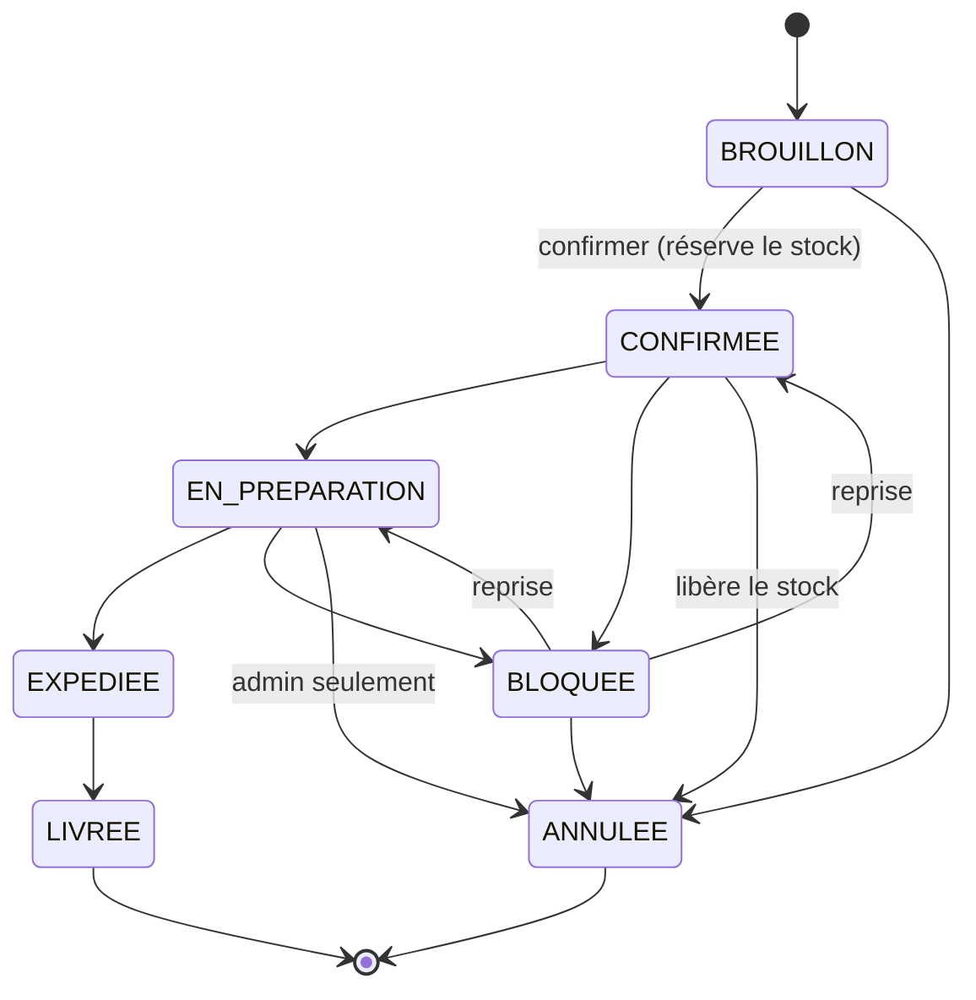
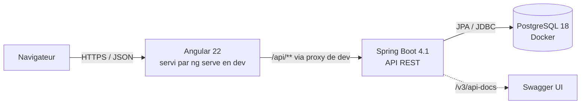
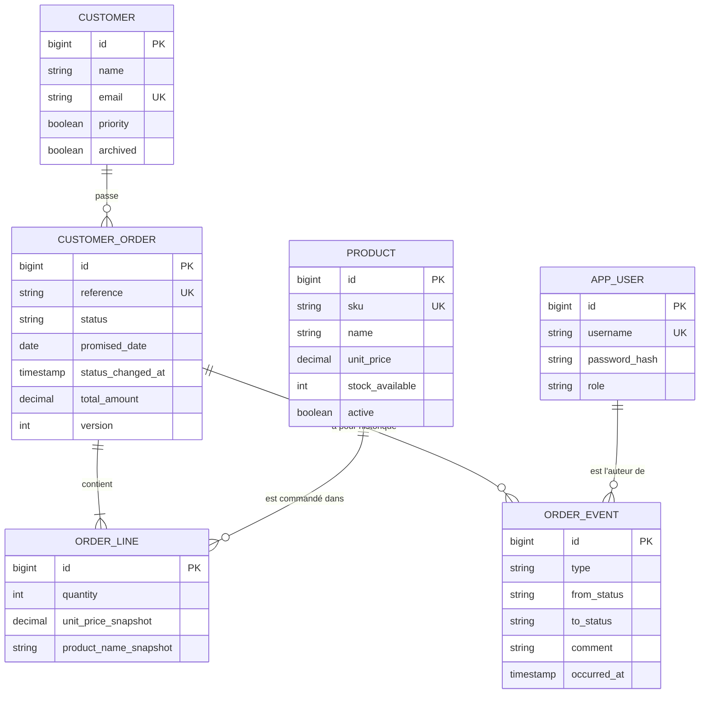

# Cadrage initial — Application de suivi des commandes

*Version 0.1 du 27 octobre 2026 · Phases 1 (audit) et 2 (cadrage) · En attente de validation de Bouba*

Ce document répond à la section 15 de la mission. **Rien n'a été initialisé** : aucun dépôt, aucun projet Angular ou Spring Boot, aucune issue, aucune carte Trello. Les décisions marquées 🔶 attendent ta validation (récapitulatif en section 9).

---

## 1. Audit de l'environnement

### 1.1 Ce que j'ai réellement exécuté

L'audit a été fait dans **mon conteneur de travail dans le cloud** (Ubuntu 24.04), pas sur ton ordinateur. Ce conteneur est éphémère : tout ce qui doit durer passera par le dépôt GitHub. Les versions de ta propre machine restent donc **inconnues** (voir section 9).

| Outil | Commande | Résultat dans le conteneur | Verdict pour Angular 22 / Spring Boot 4.1 |
|---|---|---|---|
| Node.js | `node --version` | v22.22.0 | ❌ **Trop ancien** : Angular 22 exige `^22.22.3`, `^24.15.0` ou `>=26.0.0` |
| npm | `npm --version` | 10.9.4 | ✅ |
| Angular CLI | `ng version` | non installé | À installer (localement au projet, via `npx`) |
| TypeScript (global) | `tsc --version` | 6.0.2 | Sans importance : le projet utilisera sa propre version locale |
| Java | `java -version` | OpenJDK 21.0.12 | ✅ compatible (LTS), mais voir recommandation Java 25 |
| Maven | `mvn --version` | 3.9.11 | ✅ (minimum 3.6.3). On utilisera le Maven Wrapper `./mvnw` |
| Docker | `docker --version` | 29.9.2 | ✅ |
| PostgreSQL (client) | `psql --version` | 16.15 | Client seulement. Le serveur tournera dans Docker (PostgreSQL 18) |
| Git / GitHub CLI | `git --version`, `gh --version` | 2.43.0 / 2.89.0 | ✅ |

### 1.2 Répertoires

- Répertoire de travail : vide (seulement des fichiers de configuration cachés), **pas un dépôt Git**.
- Dossier partagé du projet : vide avant ce document.
- **Aucun dépôt GitHub n'est rattaché au projet.** Je ne peux pas en créer un moi-même : il faudra que tu le crées sur GitHub, puis je le rattacherai.

Conclusion : on part d'une page blanche, rien à préserver ni à migrer.

---

## 2. Versions vérifiées et compatibilité

Sources consultées le 27/10/2026 : registre npm (`npm view`), [angular.dev/reference/versions](https://angular.dev/reference/versions), [angular.dev/reference/releases](https://angular.dev/reference/releases), [nodejs.org/dist](https://nodejs.org/dist/index.json), [docs.spring.io/spring-boot/system-requirements.html](https://docs.spring.io/spring-boot/system-requirements.html), Maven Central, [postgresql.org/docs](https://www.postgresql.org/docs/), [feuille de route Java d'Oracle](https://www.oracle.com/es/java/technologies/jvp-support-roadmap.html).

La colonne « installée » concerne mon conteneur. Rien n'est installé sur ta machine par moi.

| Composant | 1. Dernière disponible | 2. Dernière stable | 3. Retenue pour le projet | 4. Installée (conteneur) |
|---|---|---|---|---|
| Angular (`@angular/core`) | 22.3.0-next.3 (pré-version) | **22.2.3** | 22.2.x | — |
| Angular CLI / `@angular/build` | 22.3.0-next.3 | **22.2.4** | 22.2.x | — |
| Node.js | 26.12.1 (« Current », non LTS) | **24.22.1 LTS** (Krypton) ; 22.23.4 (Jod, maintenance) | **24 LTS** | 22.22.0 ❌ |
| TypeScript | 7.1.0-beta / 7.0.2 | 7.0.2 | **6.0.x** (Angular 22 exige `>=6.0 <6.1`) | 6.0.2 (global) |
| RxJS | 9.0.0-beta.1 | **7.8.2** | 7.8.x (Angular accepte `^6.5.3 \|\| ^7.4.0`) | — |
| Vitest | 5.1.0-beta.1 | 5.0.5 | Celle choisie par le CLI (`^4.0.8 \|\| ^5.0.0`) | — |
| Angular Material / CDK | 22.3.0-next.3 | 22.2.4 | 22.2.x 🔶 | — |
| Spring Boot | 4.2.0-RC1 (pré-version) | **4.1.2** | **4.1.2** | — |
| Spring Framework | — | 7.0.x | 7.0.x (géré par Spring Boot) | — |
| Java (JDK) | 27 (sept. 2026, non LTS) | 25 LTS (support Premier jusqu'en 2030), 21 LTS (jusqu'en 2028) | **25 LTS** 🔶 (Spring Boot 4.1 accepte 17 à 27) | 21.0.12 |
| Maven | non vérifié | non vérifié | ≥ 3.6.3, via Maven Wrapper | 3.9.11 |
| springdoc-openapi (Swagger UI) | 3.2.0 | 3.2.0 | 3.2.0 (construit sur Spring Boot 4.1.2) | — |
| Flyway | 13.11.1 | 13.11.1 | Version gérée par Spring Boot (à lire à l'initialisation) | — |
| Testcontainers | 2.0.5 | 2.0.5 | Version gérée par Spring Boot | — |
| PostgreSQL | 19 RC1 (15/10/2026) | **18** | **18** (image Docker `postgres:18`) | client 16.15 |

### 2.1 Points notables

- **Cycle de vie Angular** : v22 est sortie le 03/06/2026, en support actif jusqu'en juin 2027 puis LTS jusqu'en juin 2028. Bon choix pour un projet d'apprentissage d'un an.
- **Le tableau officiel n'affiche que « 22.0.x »**, mais le paquet 22.2.3 publie exactement les mêmes exigences (`engines` et `peerDependencies` lus sur npm). La compatibilité est donc confirmée pour 22.2.x.
- **TypeScript 7 est sorti mais n'est pas compatible** avec Angular 22. C'est un bon exemple de la différence entre « dernière version » et « version compatible ». Le CLI installera la bonne version.
- **Outil de compilation réel** : le CLI 22 utilise le builder `@angular/build`, dont les dépendances sont **esbuild** (0.28.2), **Vite** (8.3.0, serveur de développement) et **Rolldown** (1.2.8). **Webpack n'est pas utilisé** par défaut. Je le confirmerai en lisant `angular.json` du projet généré.
- **Valeurs par défaut de `ng new`** (lues dans `@schematics/angular` 22.2.4) : composants standalone par défaut, test runner **Vitest** (Karma reste disponible). L'option « zoneless » n'existe plus dans le schéma, ce qui indique que le mode sans zone.js est la norme ; je le vérifierai sur le projet généré.
- **Signal Forms** : la fonction `form()` de `@angular/forms/signals` est marquée `@publicApi 22.0` dans le code du paquet, donc **stable depuis la v22**. Quelques API annexes restent `@experimental`.
- **springdoc 3.2.0** est bâti sur Spring Boot 4.1.2 (POM parent vérifié), donc compatible.

---

## 3. Trois noms de produit 🔶

| Nom | Signification | Slogan |
|---|---|---|
| **Vigie** | Le marin posté en haut du mât qui repère les dangers avant qu'ils n'arrivent. | « Voir les retards avant qu'ils n'arrivent. » |
| **Sillage** | La trace laissée par un bateau : chaque commande laisse un historique lisible. | « Chaque commande laisse sa trace. » |
| **Jalon** | Un repère sur un parcours : les statuts sont des jalons contrôlés. | « Chaque étape, sous contrôle. » |

**Ma recommandation : Vigie.** Le nom porte directement ce qui rend le produit original (anticipation des retards, priorités, alertes) plutôt que la simple consultation. Il est court, prononçable en français comme en anglais, et donne un nom de package naturel (`vigie`, `com.vigie...`). Sillage serait mon second choix si tu veux mettre l'accent sur la timeline.

---

## 4. Charte graphique (4 couleurs) 🔶

| Rôle | Couleur | Hex | Usage | Contraste |
|---|---|---|---|---|
| Primaire | Bleu nuit | `#1E3A5F` | Barre de navigation, titres, boutons principaux | ≈ 11:1 sur blanc (AAA) |
| Secondaire | Sarcelle | `#0F766E` | Liens, statuts « en cours », éléments actifs | ≈ 5,5:1 sur blanc (AA) |
| Accent | Ambre | `#F59E0B` | Alertes de risque, commandes prioritaires, badges | Toujours en fond avec texte foncé `#0F172A` (≈ 8:1) ; jamais en texte sur blanc |
| Neutre | Ardoise | `#64748B` | Gamme de gris dérivée (fonds `#F1F5F9`, bordures, texte `#0F172A`) | Texte secondaire AA sur blanc |

Règles d'accessibilité retenues :

- Un statut n'est **jamais signalé par la couleur seule** : badge = couleur + icône + libellé.
- Le rouge d'erreur (formulaires, échec API) est un besoin d'accessibilité standard. Je propose une **exception** : un rouge sémantique `#B91C1C` réservé aux erreurs, hors des 4 couleurs de marque. 🔶
- Mode sombre : reporté (évolution), mais les couleurs seront déclarées en variables CSS dès le départ pour le permettre.

---

## 5. Proposition produit

### 5.1 Le pitch

**Vigie** est un poste de pilotage pour une petite boutique en ligne (par exemple un artisan qui vend sur son site) : l'équipe voit d'un coup d'œil quelles commandes avancent, lesquelles stagnent, et **dans quel ordre les traiter**. La différence avec un CRUD : le produit applique des règles métier explicites (transitions de statut, stock, délais) et **explique ses décisions** (pourquoi une transition est refusée, pourquoi une commande est prioritaire, pourquoi elle est en risque).

Ce que Vigie **ne fait pas** : pas de paiement réel, pas de transporteur réel, pas d'envoi d'e-mails. Les dates d'expédition et de livraison sont saisies par l'opérateur.

### 5.2 Utilisateurs

| Rôle | Ce qu'il fait |
|---|---|
| **Opérateur** | Crée et suit les commandes, fait avancer les statuts, consulte le dashboard |
| **Administrateur** | Tout ce que fait l'opérateur, plus : gestion du catalogue, des utilisateurs, des seuils de délai, annulation après préparation |

Les clients finaux ne se connectent pas (pas de portail client dans le MVP).

### 5.3 Scénarios principaux

1. Le matin, l'opérateur ouvre le dashboard : 3 commandes en retard, 5 en risque, la liste « à traiter en priorité » est triée par score.
2. Il ouvre une commande, voit sa timeline, la fait passer de « Confirmée » à « En préparation ». Le stock a été réservé à la confirmation.
3. Il tente de la passer directement à « Livrée » : refus avec un message clair (« Transition EN_PREPARATION → LIVREE non autorisée. Transitions possibles : EXPEDIEE, BLOQUEE, ANNULEE »).
4. Un produit manque : il met la commande en « Bloquée » avec un motif ; l'événement apparaît dans la timeline avec son nom et l'heure.
5. Il recherche toutes les commandes d'un client, en retard, sur le dernier mois.

### 5.4 Modèle de statuts



### 5.5 Règles métier

| # | Règle |
|---|---|
| R1 | La référence est générée par le serveur, unique, au format `CMD-2026-00042`. |
| R2 | Une commande a au moins une ligne ; quantité ≥ 1. |
| R3 | Le prix unitaire est **copié** dans la ligne à la création (une hausse de prix ne modifie pas les commandes existantes). Le total est calculé par le serveur. |
| R4 | Les lignes ne sont modifiables qu'en `BROUILLON`. |
| R5 | Toute transition passe par le **moteur de transitions** ; une transition absente du diagramme est refusée (HTTP 409). |
| R6 | Annulation : motif obligatoire, interdite après `EXPEDIEE`, réservée à l'admin en `EN_PREPARATION`. Un retour de `BLOQUEE` exige que la commande reprenne son statut précédent. |
| R7 | La confirmation réserve le stock et échoue si le stock est insuffisant ; l'annulation d'une commande confirmée libère le stock. Le tout dans **une seule transaction**. |
| R8 | Chaque création, modification et transition produit un **événement** horodaté avec son auteur (journal non modifiable). |
| R9 | Une commande est **en retard** si la date promise est dépassée et qu'elle n'est ni livrée ni annulée. |
| R10 | Une commande est **en risque** si elle reste dans un statut plus longtemps que le seuil configuré (ex. 48 h en préparation), ou si la date promise approche et qu'elle n'est pas expédiée. |
| R11 | Un client archivé ou un produit inactif ne peut pas figurer dans une nouvelle commande. |
| R12 | Deux opérateurs ne peuvent pas écraser la modification l'un de l'autre (verrouillage optimiste, HTTP 409). |

### 5.6 Fonctionnalités originales : évaluation et sélection

| Piste | Intérêt pédagogique | Difficulté | Maintenance | Décision |
|---|---|---|---|---|
| Moteur de règles de transition | Très fort : logique métier pure, tests unitaires, 409, unions TS côté front | Moyenne | Faible | **MVP** |
| Historique / journal d'audit / timeline | Fort : relation 1-N, transactions, auteur via Spring Security, composant timeline | Moyenne | Faible | **MVP** (un seul mécanisme d'événements sert aux trois) |
| Score de priorité explicable | Fort : calcul métier testable, affichage du « pourquoi » | Moyenne | Faible | **MVP** (version simple) |
| Détection retards / risques | Fort : dates, requêtes, seuils configurables | Moyenne | Faible | **MVP** (calcul à la lecture) |
| Recherche avancée multicritères | Très fort : RxJS `debounceTime`/`switchMap`, query params, JPA Specifications, pagination | Moyenne | Faible | **MVP** |
| Dashboard analytique | Fort : agrégations SQL, `combineLatest`, états de chargement | Moyenne | Moyenne | **MVP** (indicateurs fixes) |
| Alertes planifiées + notifications temps réel | Fort : `@Scheduled`, Server-Sent Events, Observables longs | Élevée | Moyenne | Évolution |
| Simulation « et si ? » (ex. « si l'atelier prend 2 jours de retard ») | Fort et original : réutilise le moteur de risque sans écrire en base | Moyenne | Faible | Évolution |
| Dashboard personnalisable | Moyen : persistance des préférences, drag & drop CDK | Élevée | Élevée | Évolution tardive |

Le fil conducteur : **un seul modèle d'événements** alimente l'historique, l'audit et la timeline, et **un seul service d'évaluation des délais** alimente les retards, les risques, le score et plus tard la simulation. On pratique beaucoup de concepts sans multiplier les mécanismes.

### 5.7 Score de priorité (version MVP)

Score sur 100, calculé côté serveur, renvoyé **avec son détail** :

| Critère | Points |
|---|---|
| Déjà en retard | +40 |
| Date promise dans moins de 48 h | +25 |
| En risque (seuil de statut dépassé) | +20 |
| Client marqué prioritaire | +10 |
| Montant au-dessus du seuil configuré | +5 |

L'interface affiche par exemple : « Score 65 : en retard (+40), échéance < 48 h (+25) ». Les poids sont dans une configuration, pas codés en dur.

---

## 6. MVP et évolutions

### 6.1 MVP (version 1.0)

- Authentification et deux rôles (opérateur, admin), contrôlés **côté serveur**.
- Catalogue produits avec stock simple (quantité disponible, réservation à la confirmation).
- Clients (création, modification, archivage, historique des commandes).
- Commandes : création avec lignes, modification en brouillon, consultation, annulation selon les règles.
- Moteur de transitions + timeline des événements avec auteur.
- Recherche multicritères : statut, client, période, en retard / en risque, référence ; tri et pagination ; filtres reflétés dans l'URL.
- Retards, risques et score de priorité.
- Dashboard : compteurs, répartition par statut, évolution sur 30 jours, liste prioritaire ; états chargement / erreur / vide.
- Documentation OpenAPI, migrations Flyway, Docker Compose, CI GitHub Actions, tests front et back.

### 6.2 Évolutions (après la 1.0, dans cet ordre indicatif)

1. Alertes planifiées et notifications en temps réel (SSE).
2. Simulation de scénarios « et si ? ».
3. Export CSV des recherches.
4. Mode sombre.
5. Dashboard personnalisable.
6. Déploiement d'une démo (à discuter).

Hors périmètre : paiement, transporteur, e-mails, portail client, microservices.

---

## 7. Architecture technique

### 7.1 Vue d'ensemble

Un **monorepo** avec deux applications et une base, sans microservices :



```
vigie/
├── backend/                 Spring Boot (Maven Wrapper)
├── frontend/                Angular 22
├── docs/                    cahier des charges, diagrammes Mermaid, veille-angular.md, ADR
├── docker-compose.yml       PostgreSQL 18 (+ pgAdmin optionnel)
├── .github/workflows/ci.yml build + tests front et back
└── README.md                installation et démarrage
```

### 7.2 Backend : modulaire par domaine

```
com.vigie
├── catalog      Product : controller, service, repository, dto, entity
├── customer     Customer : idem
├── order        Order, OrderLine, recherche (Specifications)
│   └── lifecycle   OrderStatus, TransitionPolicy (moteur de règles), OrderEvent
├── risk         DelayEvaluator, PriorityScorer (logique pure, sans Spring si possible)
├── dashboard    requêtes d'agrégation en lecture seule
├── security     configuration Spring Security, utilisateurs, rôles
└── common       gestion d'erreurs (ProblemDetail RFC 9457), pagination, configuration
```

Choix principaux :

- **Couches** : contrôleur (HTTP seulement) → service (règles métier, `@Transactional`) → repository (Spring Data JPA). Les entités ne sortent jamais de l'API : on expose des **DTO** (`record` Java).
- **Mapping DTO** : écrit à la main au début pour comprendre ; MapStruct seulement si la répétition devient réelle.
- **Erreurs** : un `@RestControllerAdvice` unique qui renvoie des `ProblemDetail` (400 validation, 404, 409 transition interdite ou conflit de version, 403).
- **Migrations** : Flyway (`V1__init.sql`…). Hibernate ne crée jamais le schéma (`ddl-auto=validate`).
- **Sécurité** 🔶 : je recommande une **session serveur avec cookie + protection CSRF**, que `HttpClient` d'Angular gère nativement. C'est plus simple et plus sûr pour une SPA servie au même domaine que le JWT stocké dans le navigateur. Le JWT deviendrait un exercice comparatif.
- **Tests** : JUnit + AssertJ pour la logique pure, `@WebMvcTest` pour les contrôleurs, `@DataJpaTest` + **Testcontainers PostgreSQL** pour la persistance (vrai PostgreSQL plutôt que H2, pour éviter les différences de dialecte), tests de sécurité avec `spring-security-test`.
- **Configuration** : profils `dev` et `test`, secrets via variables d'environnement, `application-example.yml` sans secret dans le dépôt.

### 7.3 Modèle de données



(`ORDER` est un mot réservé SQL, d'où `customer_order`.)

### 7.4 Endpoints (premier jet)

| Méthode | Chemin | Rôle |
|---|---|---|
| GET/POST | `/api/products` | Liste paginée / création (admin) |
| GET/PUT | `/api/products/{id}` | Détail / modification (admin) |
| GET/POST | `/api/customers` | Liste paginée filtrable / création |
| GET/PUT | `/api/customers/{id}` | Détail / modification |
| GET | `/api/customers/{id}/orders` | Historique des commandes d'un client |
| GET | `/api/orders?status=&customerId=&from=&to=&late=&atRisk=&q=&page=&size=&sort=` | Recherche multicritères |
| POST | `/api/orders` | Création (brouillon) |
| GET/PUT | `/api/orders/{id}` | Détail (avec score et risque) / modification des lignes en brouillon |
| GET | `/api/orders/{id}/allowed-transitions` | Transitions possibles pour l'utilisateur courant |
| POST | `/api/orders/{id}/transitions` | Corps `{ "target": "EXPEDIEE", "comment": "..." }` |
| GET | `/api/orders/{id}/events` | Timeline |
| GET | `/api/dashboard/summary?from=&to=` | Indicateurs |
| POST | `/api/auth/login`, `/api/auth/logout`, GET `/api/auth/me` | Session |

Les transitions sont un **POST sur une sous-ressource** plutôt qu'un `PUT status` : cela traduit une action métier, pas une modification de champ.

### 7.5 Frontend : organisé par fonctionnalité

```
src/app/
├── core/        authentification, intercepteurs (erreurs, chargement), layout, garde de routes
├── shared/      composants UI réutilisables (badge de statut, état vide, pagination), pipes
└── features/
    ├── dashboard/
    ├── orders/      liste + recherche, détail + timeline, formulaire de création
    ├── customers/
    └── catalog/
```

Choix principaux :

- **Standalone partout**, routes chargées à la demande (`loadComponent` / `loadChildren`) par fonctionnalité.
- **État** : Signals pour l'état local et dérivé (`signal`, `computed`), **RxJS** là où il y a des flux dans le temps (recherche avec `debounceTime` + `distinctUntilChanged` + `switchMap`, combinaison de filtres avec `combineLatest`, enchaînement séquentiel d'actions avec `concatMap`). Pas de bibliothèque de store (NgRx) : non justifiée à cette taille.
- **Types** : `type OrderStatus = 'BROUILLON' | 'CONFIRMEE' | ...` et union discriminée `type LoadState<T> = { status: 'loading' } | { status: 'success'; data: T } | { status: 'error'; error: ApiError }`.
- **Formulaires** 🔶 : je recommande les **Reactive Forms** comme approche principale (le formulaire de commande avec `FormArray` de lignes est un excellent cas), et les **Signal Forms** (stables en v22) dans un exercice comparatif sur le formulaire client. Les formulaires pilotés par template feront l'objet d'un petit exercice indépendant.
- **Interface** 🔶 : je recommande **Angular Material + CDK 22.2.x** (table, pagination, dialogues et champs accessibles), thémé avec la charte. Alternative : CSS maison, plus formateur mais plus long.
- **Graphiques** 🔶 : la répartition par statut se fait en simple SVG/CSS (sans dépendance). Pour l'évolution temporelle, on décidera au moment venu entre un composant SVG maison et une bibliothèque (Chart.js ou ECharts, versions non encore vérifiées).
- **Qualité** : ESLint (angular-eslint) et Prettier ; tests Vitest avec `HttpTestingController` pour les appels HTTP.

### 7.6 Git, CI et organisation

- `main` protégée, branches `feat/…`, `fix/…`, `docs/…` ; **pas de branche `develop`** (aucune valeur pour un développeur seul).
- Commits au format Conventional Commits (`feat(order): add transition policy`).
- Une Pull Request par incrément, avec une checklist d'auto-revue ; tags `v0.1.0`, `v0.2.0`… jusqu'à `v1.0.0`.
- GitHub Actions : deux jobs (backend `./mvnw verify` avec Testcontainers, frontend lint + tests + build).
- Trello : colonnes Backlog, À faire, En cours, À tester, Terminé. Je n'ai pas d'accès à Trello : je te fournirai la liste des cartes prête à copier.

---

## 8. Feuille de route

Chaque incrément est **vertical** (de l'écran à la base) et livré par une PR, avec sa fiche pédagogique, ses tests et un exercice.

| # | Incrément | Concepts principaux appris |
|---|---|---|
| 0 | **Fondations** : dépôt, monorepo, Docker Compose PostgreSQL, squelettes Spring Boot et Angular, CI, README, cahier des charges et diagrammes | Structure d'un projet CLI et Spring Boot, Node/npm/CLI/compilateur/bundler, profils, Flyway, GitHub Actions |
| 1 | **Catalogue produits** (lecture puis création/modification admin) | Composants, bindings, `@if`/`@for`, services et DI, HttpClient, contrôleur/service/repository, DTO, Bean Validation, ProblemDetail |
| 2 | **Clients + recherche paginée** | Pagination/tri Spring Data, `debounceTime`/`distinctUntilChanged`/`switchMap`, router et query params, lazy loading |
| 3 | **Authentification et rôles** | Spring Security, sessions et CSRF, intercepteurs, garde de route, tests d'autorisation |
| 4 | **Création de commande** | Reactive Forms, `FormArray`, validateurs, transactions, référence unique, copie des prix, relations JPA |
| 5 | **Cycle de vie + timeline** | Moteur de transitions testable, 409, verrouillage optimiste, événements, unions TypeScript, communication entre composants (`input()`/`output()` et `@Input`/`@Output`), hooks de cycle de vie |
| 6 | **Recherche avancée des commandes** | JPA Specifications, `combineLatest`, filtres dans l'URL, tests de filtres |
| 7 | **Retards, risques, score de priorité** | Logique métier pure, configuration, dates et fuseaux, affichage explicable |
| 8 | **Dashboard** | Requêtes d'agrégation, états chargement/erreur/vide, `LoadState<T>`, graphiques |
| 9 | **Consolidation → v1.0** | Revue sécurité, couverture de tests, installation reproductible, bilan pédagogique |

En parallèle : `docs/veille-angular.md` (29 questions) sera rempli **au fil des incréments**, chaque réponse étant reliée au code où la notion apparaît. Les fiches pédagogiques iront dans `docs/fiches/`.

---

## 9. Points à confirmer

**Décisions qui t'appartiennent :**

1. **Nom** : Vigie (recommandé), Sillage ou Jalon ?
2. **Charte** : les 4 couleurs, et l'exception du rouge d'erreur `#B91C1C` ?
3. **Java 25 LTS** (recommandé, support jusqu'en 2030) ou **Java 21 LTS** (déjà répandu, support jusqu'en 2028) ?
4. **Authentification** : session + CSRF (recommandé) ou JWT ?
5. **Formulaires** : Reactive Forms en principal + Signal Forms en exercice (recommandé), ou Signal Forms en principal ?
6. **UI** : Angular Material (recommandé) ou CSS maison ?
7. **Stock dans le MVP** : je l'ai inclus sous forme simple (réservation à la confirmation). On le garde ?

**Informations dont j'ai besoin :**

8. **Ta machine de développement** : système (Windows, macOS, Linux) et la sortie de `node -v`, `npm -v`, `java -version`, `mvn -v`, `docker --version`, `git --version`. Si ton Node est inférieur à 22.22.3, il faudra installer **Node 24 LTS** (je te donnerai la marche à suivre).
9. **Dépôt GitHub** : crée un dépôt vide (nom suggéré `vigie`, public ou privé selon ton choix) et dis-le-moi ; je le rattacherai au projet. Je ne peux pas le créer moi-même.
10. **Langue** : je propose le code en anglais (classes, variables, endpoints) et l'interface et la documentation en français. Les valeurs de statut côté API resteraient en français (`BROUILLON`…) ou en anglais (`DRAFT`…) ? Je recommande l'anglais pour le code et des libellés français dans l'interface.
11. **Rythme** : combien d'heures par semaine comptes-tu y consacrer ? Cela permettra de calibrer la taille des incréments.

Dès que tu valides (même partiellement), je passe à l'incrément 0 : uniquement des actions réversibles, et rien de distant (dépôt, Trello) sans ton accord explicite.
