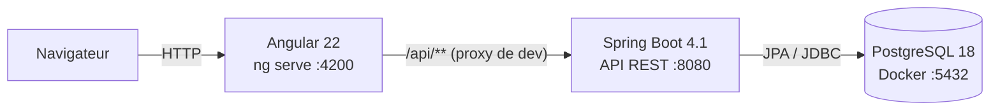

# Architecture

## Vue d'ensemble



Un monorepo, deux applications, une base. Pas de microservices : la taille du produit ne le justifie pas.

## Backend : organisé par domaine

```
com.suivicommandes
├── catalog      produits et stock
├── customer     clients
├── order        commandes, lignes, recherche
│   └── lifecycle   statuts, moteur de transitions, événements
├── risk         retards, risques, score de priorité (logique pure)
├── dashboard    indicateurs en lecture seule
├── security     Spring Security, utilisateurs, rôles
└── common       erreurs (ProblemDetail), configuration
```

Dans chaque domaine : `Controller` (HTTP uniquement) → `Service` (règles métier, transactions) → `Repository` (Spring Data JPA). Les entités JPA ne sortent jamais de l'API : on expose des DTO (`record`).

## Frontend : organisé par fonctionnalité

```
src/app/
├── core/        authentification, intercepteurs, gardes
├── shared/      composants réutilisables (badge de statut, état vide...)
└── features/    une page ou un ensemble de pages par domaine, chargées à la demande
```

## Chaîne de build du frontend (vérifiée sur le projet généré)

| Élément | Rôle |
|---|---|
| **Node.js** | Exécute les outils JavaScript sur ta machine (pas l'application dans le navigateur) |
| **npm** | Installe les dépendances décrites dans `package.json` |
| **Angular CLI** (`ng`) | Commandes `new`, `serve`, `build`, `test`, `generate` |
| **`@angular/build:application`** | Le builder déclaré dans `angular.json` |
| **Compilateur Angular** (`@angular/compiler-cli`) + **TypeScript 6.0** | Transforment templates et TypeScript en JavaScript |
| **esbuild** | Regroupe et optimise le JavaScript (bundler) |
| **Vite** | Serveur de développement de `ng serve` |
| **Vitest** + jsdom | Lance les tests unitaires dans un DOM simulé |
| **Navigateur** | Exécute le JavaScript produit |

**Webpack n'est pas utilisé.** Il l'était par l'ancien builder `@angular-devkit/build-angular:browser`.
