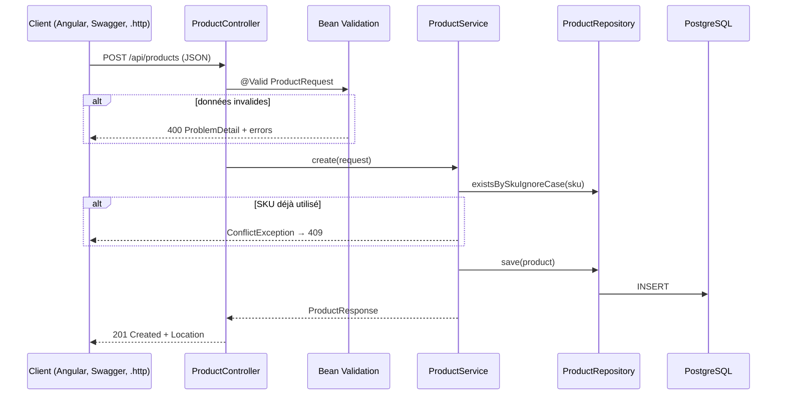

# Fiche J2 : API du catalogue produits

## 1. Besoin utilisateur

L'administrateur doit pouvoir enregistrer les produits vendus (référence, nom, prix, stock), les retrouver rapidement et les retirer de la vente sans perdre l'historique des commandes passées.

## 2. Problème technique

Exposer une API REST fiable : refuser les données invalides avec un message clair, empêcher les doublons de référence (SKU), renvoyer des listes paginées et des erreurs cohérentes, sans mélanger HTTP, règles métier et accès aux données.

## 3. Concepts à apprendre

- L'architecture en couches : **contrôleur → service → repository**.
- Les entités JPA et le mapping objet ↔ table.
- Les **DTO** (`record`) et pourquoi ne pas exposer les entités.
- **Bean Validation** (`@Valid`, `@NotBlank`, `@Size`...).
- Les **transactions** (`@Transactional`) et l'entité « managée ».
- La **gestion centralisée des erreurs** (`@RestControllerAdvice`) et le format **ProblemDetail**.
- La **pagination et le tri** avec `Pageable`.
- Les codes HTTP : 200, 201, 400, 404, 409.
- La documentation **OpenAPI / Swagger**.

## 4. Solution



| Endpoint | Rôle | Codes |
|---|---|---|
| `GET /api/products?q=&page=&size=&sort=` | Recherche paginée par SKU ou nom | 200, 400 (tri inconnu) |
| `GET /api/products/{id}` | Détail | 200, 404 |
| `POST /api/products` | Création | 201, 400, 409 |
| `PUT /api/products/{id}` | Modification, désactivation | 200, 400, 404, 409 |

Pas de `DELETE` : un produit commandé doit rester en base. On le désactive avec `"active": false`.

## 5. Fichiers concernés

| Fichier | Responsabilité |
|---|---|
| `db/migration/V2__create_product.sql` | Table, contraintes `CHECK`, index unique sur `LOWER(sku)` |
| `catalog/Product.java` | Entité JPA, sans setters publics |
| `catalog/ProductRepository.java` | Requêtes générées par Spring Data |
| `catalog/dto/ProductRequest.java` | Données reçues + règles de validation |
| `catalog/dto/ProductResponse.java` | Données renvoyées + conversion depuis l'entité |
| `catalog/ProductService.java` | Règles métier, transactions |
| `catalog/ProductController.java` | Traduction HTTP ↔ Java, codes de réponse |
| `common/error/*` | Exceptions métier et traduction en ProblemDetail |
| `common/web/PageResponse.java` | Format JSON stable des listes paginées |
| `common/web/OpenApiConfig.java` | En-tête de la documentation Swagger |
| `backend/http/products.http` | Requêtes prêtes à lancer à la main |

## 6. Le code expliqué

**Pourquoi un DTO plutôt que l'entité ?** L'entité `Product` décrit la table. Si on la renvoyait directement, chaque nouvelle colonne apparaîtrait dans l'API sans qu'on l'ait décidé, et un client pourrait envoyer un `id` ou un `createdAt` que l'on ne veut pas qu'il choisisse. `ProductRequest` dit exactement ce que le client a le droit d'envoyer ; `ProductResponse` dit exactement ce qu'il reçoit.

**Pourquoi la règle « SKU unique » est-elle dans le service et en base ?**

```java
if (productRepository.existsBySkuIgnoreCase(sku)) {
    throw new ConflictException("Le SKU " + sku + " est déjà utilisé.");
}
```

Le service donne un message clair dans le cas normal. Mais si deux requêtes arrivent au même instant, les deux vérifications peuvent passer avant les deux insertions. L'index unique `uk_product_sku` est alors le filet de sécurité : la base refuse la seconde insertion, et `GlobalExceptionHandler` transforme `DataIntegrityViolationException` en 409, **sans** renvoyer le message SQL.

**Pourquoi `update` n'appelle pas `save()` ?** Dans une méthode `@Transactional`, l'entité renvoyée par `findById` est *managée* : JPA surveille ses modifications et écrit un `UPDATE` au moment du commit. C'est le *dirty checking*.

**`@Transactional(readOnly = true)` sur la classe** : toutes les lectures sont en transaction lecture seule (optimisation et intention claire) ; les méthodes d'écriture redéclarent `@Transactional`.

**Le format d'erreur** (vérifié en lançant l'API) :

```json
{
  "status": 400,
  "title": "Données invalides",
  "detail": "Un ou plusieurs champs sont invalides.",
  "instance": "/api/products",
  "errors": {
    "name": "ne doit pas être vide",
    "sku": "ne doit contenir que des lettres, chiffres et tirets",
    "unitPrice": "doit être supérieur ou égal à 0.00"
  }
}
```

Les messages sont en français grâce à `spring.web.locale: fr` dans `application.yml`.

## 7. Alternatives

| Choix | Alternative | Pourquoi ce choix |
|---|---|---|
| Mapping DTO écrit à la main | MapStruct | Une seule entité : la librairie n'apporte rien encore et cache ce qui se passe |
| `PageResponse` maison | Renvoyer `Page<T>` | Le JSON de `Page` dépend de Spring Data ; notre format reste stable pour Angular |
| Désactivation | `DELETE` physique | Les commandes passées doivent garder leur produit |
| Requête dérivée du nom de méthode | `@Query` JPQL, Specifications | Suffisant pour un seul critère ; les Specifications arrivent au J9 pour les filtres combinés |
| Tests d'intégration avec Testcontainers | `@WebMvcTest` + mock du service | On teste la vraie chaîne jusqu'à PostgreSQL ; le test unitaire du service couvre déjà les règles isolées |

## 8. Tests écrits

| Test | Scénario | Résultat attendu | Risque couvert |
|---|---|---|---|
| `ProductServiceTest.create_normaliseLeSku...` | Création avec `" tasse-01 "` | SKU `TASSE-01`, produit actif | Doublons déguisés par la casse ou les espaces |
| `create_refuseUnSkuDejaUtilise` | SKU déjà en base | `ConflictException`, aucun `save` | Doublon de référence |
| `update_produitInexistant_leveNotFound` | id inconnu | `NotFoundException` | Erreur 500 au lieu de 404 |
| `update_refuseUnChangementDeSku` | SKU différent à la modification | `ConflictException` | Référence métier modifiée |
| `update_conserveLEtatActifSiNonFourni` | `active` absent | État inchangé | Réactivation involontaire |
| `ProductApiIntegrationTest` (7 tests) | 201 + Location, 400 avec champs, 409 en double (casse différente), recherche paginée, 400 tri inconnu, 404, désactivation | Codes et JSON attendus | Régression de bout en bout, jusqu'à PostgreSQL |

Résultat vérifié le 27/10/2026 : **13 tests, 0 échec** (`./mvnw verify`). Swagger UI répond sur <http://localhost:8080/swagger-ui.html>.

## 9. Erreurs fréquentes

- **Oublier `@Valid`** : les annotations du DTO sont alors ignorées sans aucun message.
- **Exposer l'entité** : boucles infinies en JSON dès qu'il y a des relations, fuite de champs internes.
- **Logique métier dans le contrôleur** : impossible à tester sans HTTP, dupliquée dès qu'un autre point d'entrée apparaît.
- **`@Transactional` sur une méthode privée** ou appelée depuis la même classe : Spring ne l'intercepte pas.
- **Renvoyer 500 pour une erreur du client** (tri inconnu, id absent) : c'est 400 ou 404.
- **Modifier `V2__create_product.sql` après l'avoir appliquée** : Flyway refuse de démarrer (somme de contrôle différente). Il faut une `V3`.

## 10. Exercice

1. Lance l'API et ouvre Swagger UI. Crée trois produits, dont un avec un SKU en minuscules. Que renvoie l'API ?
2. Ajoute une règle : **le nom d'un produit doit faire au moins 3 caractères**. Où la mets-tu ? Écris le test qui le prouve (indice : `ProductApiIntegrationTest`).
3. Ajoute un paramètre `active` à la recherche (`GET /api/products?active=true`) en écrivant la méthode de repository correspondante. Que se passe-t-il si on combine `q` et `active` ? Pourquoi les Specifications du J9 seront-elles plus pratiques ?
4. Explique à voix haute, sans regarder le code, le chemin d'une requête `PUT` qui modifie le SKU.

**Questions de révision**

- Quelle différence entre 400, 404 et 409 ?
- Pourquoi vérifier l'unicité à la fois dans le service et dans la base ?
- Qu'est-ce qu'une entité « managée » ?
