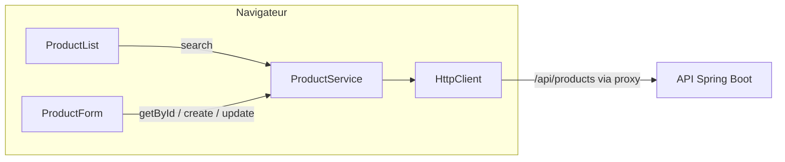

# Fiche J3 : écrans du catalogue

## 1. Besoin utilisateur

Depuis le navigateur, l'administrateur consulte le catalogue page par page, cherche un produit, en crée un et le modifie. Il comprend immédiatement ce qui ne va pas : champ manquant, SKU déjà utilisé, serveur arrêté.

## 2. Problème technique

Relier Angular à l'API du J2 proprement : un appel HTTP typé, des états d'écran explicites (chargement, succès, vide, erreur), un formulaire validé côté client **et** capable d'afficher les erreurs du serveur, sans réponse périmée qui écrase la bonne.

## 3. Concepts à apprendre

- Composants standalone, templates, **bindings** (interpolation, propriété, événement).
- **Control flow** : `@if`, `@else`, `@let`.
- **Services** et **injection de dépendances** (`inject`, `providedIn: 'root'`).
- **HttpClient**, **Observables**, `subscribe`, opérateurs `switchMap`, `map`, `catchError`, `startWith`.
- **Signals** (`signal`, `update`, `toObservable`) pour l'état local.
- **Union discriminée** `LoadState<T>`.
- **Reactive Forms** : `FormBuilder`, `Validators`, `setErrors`, `getRawValue`.
- Router : routes enfants chargées à la demande, paramètre de route reçu dans un `input()`, providers de route.
- Hook `ngOnInit`.
- Tests : `HttpTestingController`, doublures de service, tests de formulaire.

## 4. Solution



| Route | Composant | Rôle |
|---|---|---|
| `/catalogue` | `ProductList` | Recherche, tableau paginé, états chargement/vide/erreur |
| `/catalogue/nouveau` | `ProductForm` | Création |
| `/catalogue/:id` | `ProductForm` | Modification (SKU verrouillé) |

Choix d'interface : **Angular Material 22.2** (tableau, paginateur, champs, boutons, snackbar), thémé avec les couleurs de la charte, libellés en français.

## 5. Fichiers concernés

| Fichier | Responsabilité |
|---|---|
| `core/api/api.models.ts` | `Page<T>`, `ApiProblem`, `LoadState<T>` |
| `core/api/api-error.ts` | Transforme une erreur HTTP en message lisible |
| `core/i18n/french-locale.ts` | Formats français des pipes (`12,50 €`) |
| `shared/material/french-paginator-intl.ts` | Paginateur en français, fourni au niveau des routes |
| `features/catalog/product.model.ts` | Types `Product`, `ProductRequest`, `ProductQuery` |
| `features/catalog/product.service.ts` | Appels HTTP |
| `features/catalog/catalog.routes.ts` | Routes du catalogue |
| `features/catalog/product-list/*` | Liste |
| `features/catalog/product-form/*` | Formulaire |
| `app.config.ts`, `app.routes.ts`, `app.html` | `provideHttpClient`, route `/catalogue`, lien de menu |
| `styles.scss` | Thème Material + charte |

## 6. Le code expliqué

**L'état de la liste est une union discriminée :**

```ts
export type LoadState<T> =
  | { status: 'loading' }
  | { status: 'success'; data: T }
  | { status: 'error'; message: string };
```

Impossible d'avoir à la fois `data` et `message`, ou d'oublier un cas : dans le template, `current.data` n'est accessible qu'à l'intérieur de `@if (current.status === 'success')`. Le compilateur le vérifie.

**Le chargement réagit aux critères :**

```ts
toObservable(this.query).pipe(
  switchMap((query) =>
    this.productService.search(query).pipe(
      map((page) => ({ status: 'success', data: page })),
      catchError((error) => of({ status: 'error', message: errorMessage(error) })),
      startWith({ status: 'loading' }),
    ),
  ),
  takeUntilDestroyed(),
).subscribe((state) => this.state.set(state));
```

1. `query` est un signal ; `toObservable` le transforme en flux.
2. À chaque nouvelle valeur, `switchMap` lance une recherche **et annule la précédente**.
3. `startWith` émet d'abord « chargement », `map` transforme la page en « succès », `catchError` transforme l'erreur en « erreur » **sans casser le flux** (la recherche suivante fonctionnera).
4. `takeUntilDestroyed` se désabonne quand on quitte la page.

Changer de page ou rechercher revient donc à **modifier le signal** : `this.query.update(q => ({ ...q, page: 2 }))`.

**Le formulaire affiche les erreurs du serveur sous les champs :**

```ts
if (problem?.status === 400 && problem.errors) {
  for (const [field, message] of Object.entries(problem.errors)) {
    this.form.get(field)?.setErrors({ server: message });
  }
}
```

Les noms de champs du DTO Java (`name`, `sku`...) sont identiques à ceux du formulaire : c'est ce contrat qui rend cette boucle possible.

**`getRawValue()` et non `value`** : en modification, le champ SKU est désactivé ; `form.value` l'omettrait, alors que l'API l'attend.

**Paramètre de route → input :** grâce à `withComponentInputBinding()`, `/catalogue/12` remplit `id = input<string>()`. `ngOnInit` s'exécute après que cet input a reçu sa valeur : c'est le bon moment pour charger le produit.

**Pourquoi le paginateur français est-il fourni dans les routes du catalogue ?** Mis dans `app.config.ts`, il importait Angular Material dès le démarrage : le bundle initial passait de 320 kB à 633 kB et dépassait le budget de 500 kB. Fourni au niveau de la route, il n'est chargé qu'avec le catalogue.

## 7. Alternatives

| Choix | Alternative | Pourquoi ce choix |
|---|---|---|
| `toObservable` + `switchMap` | `httpResource()` / `rxResource()` | API plus récente et plus courte, mais elle cache le mécanisme qu'on veut apprendre ici |
| État dans le composant (signals) | Store global (NgRx, service d'état) | L'état n'est utilisé que par cette page |
| Reactive Forms | Template-driven, Signal Forms | Voir veille Q27 ; le formulaire de commande du J7 en profitera |
| Angular Material | CSS maison, Tailwind | Composants accessibles prêts (tableau, paginateur) ; décision du cadrage |
| Même formulaire pour création et modification | Deux composants | 95 % du code est commun |

## 8. Tests écrits

| Test | Scénario | Résultat attendu | Risque couvert |
|---|---|---|---|
| `ProductService` (3) | Recherche, recherche vide, création puis modification | Bonne URL, bonne méthode, bons paramètres ; pas de `q` vide | Contrat HTTP cassé |
| `ProductList` : affiche les produits | Service renvoie un produit | Une ligne, `12,50`, « Actif », « 1 – 1 sur 1 » | Rendu, format français |
| `ProductList` : liste vide | Service renvoie 0 produit | Message « Aucun produit ne correspond » | Écran blanc |
| `ProductList` : erreur API | Service renvoie un 400 ProblemDetail | Message `detail` dans une alerte | Erreur silencieuse |
| `ProductList` : requête initiale | Démarrage | `page 0, size 10, sort name,asc` | Paramètres par défaut cassés |
| `ProductForm` : invalide | Envoi d'un formulaire vide | Pas d'appel API, messages sous SKU et Nom | Requêtes inutiles |
| `ProductForm` : succès | Saisie valide | `create` appelé avec le bon objet, retour au catalogue | Données mal transmises |
| `ProductForm` : conflit 409 | SKU déjà pris | Message dans l'alerte | Conflit non signalé |
| `ProductForm` : 400 serveur | Erreur sur `name` | Message serveur sous le champ | Validation serveur invisible |

Résultats vérifiés le 27/10/2026 : **13 tests frontend réussis**, lint sans erreur, build sous le budget (320 kB initial). Parcours complet testé dans Chromium contre la vraie API : liste vide, erreurs de saisie, création, conflit de SKU, modification avec SKU verrouillé, affichage mobile sans défilement horizontal de la page.

## 9. Erreurs fréquentes

- **Oublier `subscribe()`** : la requête HTTP ne part jamais.
- **Utiliser `mergeMap` au lieu de `switchMap`** pour une recherche : une vieille réponse peut écraser la nouvelle.
- **`catchError` placé après `switchMap`** au lieu de dedans : la première erreur termine le flux, plus aucune recherche ne fonctionne.
- **Lire `form.value` avec un champ désactivé** : le champ disparaît de l'objet.
- **Modifier un champ non-signal** dans une application *zoneless* : l'écran ne se met pas à jour.
- **Croire que la validation Angular protège l'API** : un appel direct (Swagger, curl) la contourne, d'où la validation du J2.
- **Importer un module lourd dans `app.config.ts`** : il est chargé dès le démarrage (voir le budget de build).

## 10. Exercice

1. Dans la liste, ajoute un tri : un clic sur l'en-tête « Prix » trie par prix (indice : `MatSortModule`, puis `this.query.update(...)` avec `sort: 'unitPrice,desc'`).
2. Ajoute un bouton « Désactiver » sur chaque ligne active, qui appelle `update` avec `active: false` puis recharge la liste.
3. Écris le test qui vérifie que « Réessayer » relance la recherche après une erreur.
4. Sans regarder la fiche, explique à voix haute ce que fait chaque opérateur du `pipe` de `ProductList`.

**Questions de révision**

- Pourquoi `switchMap` et pas `mergeMap` ici ?
- Que garantit le type `LoadState<T>` que trois booléens `loading`, `error`, `data` ne garantissent pas ?
- Où la règle « le SKU ne se modifie pas » est-elle appliquée, et laquelle fait foi ?
