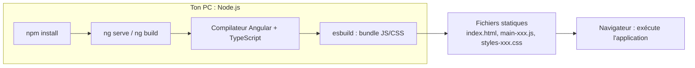
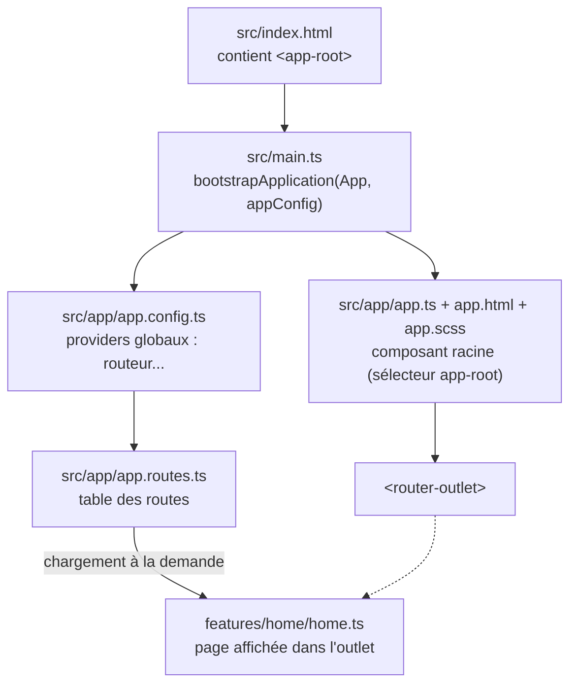
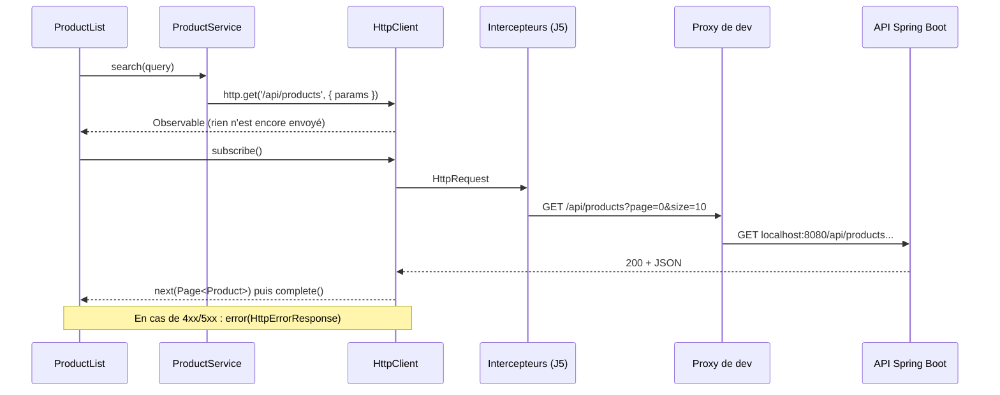

# Veille technologique : Angular

*Version Angular retenue : **22.2** (vérifiée le 27/10/2026). Chaque réponse est complétée le jour où la notion apparaît dans le projet, avec : explication accessible, réponse technique, exemple, référence officielle, lien avec le projet, exercice et question de révision.*

| # | Question | Jour | État |
|---|---|---|---|
| 1 | Qu'est-ce qu'Angular et quel est son rôle dans le développement ? Quelle est sa dernière version ? | J1 | ✅ |
| 2 | Quelles sont les principales caractéristiques et avantages d'Angular par rapport à d'autres frameworks JavaScript ? | J1 | ✅ |
| 3 | C'est quoi un CLI Angular ? | J1 | ✅ |
| 4 | C'est quoi Node ? Quelle est sa version actuelle ? | J1 | ✅ |
| 5 | Quel est le lien entre Node et Angular ? | J1 | ✅ |
| 6 | Comment créer un projet Angular ? | J1 | ✅ |
| 7 | Expliquez à l'aide d'un schéma la structure d'une application Angular (le socle généré par Angular CLI). | J1 | ✅ |
| 8 | Pouvez-vous expliquer brièvement le concept de composants et de directives dans Angular ? | J3 | ✅ |
| 9 | Les cycles de vie d'un composant. | J7 | ⬜ |
| 10 | Expliquer le contenu d'un composant Angular. | J3 | ✅ |
| 11 | C'est quoi un Observable ? C'est quoi une Promise ? | J3 | ✅ |
| 12 | Différence entre un Observable et une Promise. | J3 | ✅ |
| 13 | Qu'est-ce que RxJS ? Donnez quelques opérateurs RxJS et leurs rôles. | J4 | ⬜ |
| 14 | Comment relier une API possédant des endpoints à un projet Angular ? | J3 | ✅ |
| 15 | Décrire le mécanisme d'un appel HTTP en Angular. | J3 | ✅ |
| 16 | Qu'est-ce que le binding ? | J3 | ✅ |
| 17 | Citez et expliquez les différents types de binding. | J3 | ✅ |
| 18 | Quelle est la différence entre le binding unidirectionnel et bidirectionnel dans Angular ? | J3 | ✅ |
| 19 | Différents moyens d'échange de données entre composants en Angular. | J7 | ⬜ |
| 20 | Expliquer ce que sont @Input et @Output et leurs utilisations. | J7 | ⬜ |
| 21 | C'est quoi le lazy loading ? | J4 | 🔄 première utilisation au J1 |
| 22 | C'est quoi un service en Angular ? | J3 | ✅ |
| 23 | C'est quoi un provider en Angular ? | J5 | ⬜ |
| 24 | C'est quoi une directive ? | J3 | ✅ |
| 25 | C'est quoi un provider en Angular ? (doublon de la question 23) | J5 | ↪ voir 23 |
| 26 | Pouvez-vous citer quelques balises structurelles couramment utilisées dans les templates Angular ? | J3 | ✅ |
| 27 | Citer les différentes méthodes d'implémentation d'un formulaire en Angular. | J3, J7 | ✅ |
| 28 | C'est quoi Webpack ? Il représente quoi pour Angular ? | J1 | ✅ |
| 29 | Qu'est-ce qu'un « type union » en TypeScript et dans quelles situations est-il utilisé ? | J8 | ⬜ |

> Les questions 23 et 25 sont identiques dans l'énoncé : la 25 renvoie à la 23. Les questions 8 et 24 se recouvrent : la 8 présente composants et directives ensemble, la 24 détaille les directives.

---

## 1. Qu'est-ce qu'Angular et quel est son rôle dans le développement ? Quelle est sa dernière version ?

**En clair** : Angular est un framework pour construire des applications web qui tournent dans le navigateur. Il fournit tout le nécessaire « clé en main » : composants, navigation, formulaires, appels HTTP, tests.

**Réponse technique** : framework open source maintenu par Google, écrit en TypeScript, pour construire des *Single Page Applications* (SPA). L'application est chargée une fois, puis le navigateur met à jour l'affichage sans recharger la page. Angular apporte un système de composants, un moteur de templates compilé à l'avance, l'injection de dépendances, un routeur, des formulaires, un client HTTP et une réactivité fondée sur les **Signals**.

**Exemple** :

```ts
@Component({
  selector: 'app-root',
  template: `<h1>{{ appName }}</h1>`,
})
export class App {
  protected readonly appName = 'Suivi des commandes';
}
```

**Référence** : <https://angular.dev/overview>

**Lien avec le projet** : tout le dossier `frontend/` ; le composant racine est `frontend/src/app/app.ts`.

**Exercice** : liste trois choses que fait Angular et qu'il faudrait coder soi-même avec du JavaScript pur.

**Révision** : qu'est-ce qu'une SPA, et quel avantage pour l'utilisateur ?

### Dernière version

**En clair** : on utilise **Angular 22.2**, la version stable actuelle. On ne prend jamais une version « next » (préversion) pour un projet.

**Réponse technique** : Angular publie une version majeure environ tous les six mois. Chaque majeure a 6 mois de support actif puis 12 mois de LTS. La v22 est sortie le 03/06/2026, en support actif jusqu'en juin 2027, puis LTS jusqu'en juin 2028. Elle impose **Node.js `^22.22.3 || ^24.15.0 || >=26.0.0`**, **TypeScript `>=6.0 <6.1`** et **RxJS `^6.5.3 || ^7.4.0`**.

Il faut distinguer :

| | Exemple au 27/10/2026 |
|---|---|
| Dernière version publiée | 22.3.0-next.3 (préversion) |
| Dernière version stable | 22.2.3 |
| Compatible avec le projet | 22.2.x |
| Installée | voir `frontend/package.json` |

**Exemple** :

```bash
npx ng version
```

**Référence** : <https://angular.dev/reference/versions>, <https://angular.dev/reference/releases>

**Lien avec le projet** : `frontend/package.json` (`"@angular/core": "^22.2.0"`, `"typescript": "~6.0.2"`).

**Exercice** : lance `npx ng version` dans `frontend/` et retrouve les versions d'Angular, de TypeScript et de RxJS.

**Révision** : pourquoi TypeScript 7, pourtant sorti, n'est-il pas utilisable ici ?

## 2. Quelles sont les principales caractéristiques et avantages d'Angular par rapport à d'autres frameworks JavaScript ?

**En clair** : tout est fourni et cohérent, le typage évite beaucoup d'erreurs, et la structure imposée aide à garder un gros projet lisible.

**Réponse technique** :

- **Framework complet** : routeur, formulaires, HTTP, tests, animations, sans assembler des bibliothèques disparates.
- **TypeScript** : erreurs détectées à la compilation, autocomplétion.
- **Compilation à l'avance** (AOT) : les templates sont vérifiés et transformés en JavaScript au build.
- **Injection de dépendances** : code découplé et facile à tester.
- **Signals** : réactivité fine, sans zone.js depuis les dernières versions.
- **Outillage officiel** : CLI, migrations automatiques (`ng update`), calendrier de versions prévisible.

Limites : courbe d'apprentissage plus raide que des bibliothèques plus légères, et davantage de concepts à maîtriser au départ.

Comparaison rapide :

| | Angular | React | Vue |
|---|---|---|---|
| Nature | Framework complet | Bibliothèque d'interface | Framework progressif |
| Langage | TypeScript imposé | JavaScript ou TypeScript (JSX) | JavaScript ou TypeScript |
| Routeur, formulaires, HTTP | Fournis officiellement | Bibliothèques tierces au choix | Routeur officiel, le reste au choix |
| Injection de dépendances | Intégrée | Absente (Context, hooks) | Simple (`provide`/`inject`) |
| Réactivité | Signals + RxJS | Hooks (`useState`...) | Refs réactives |
| Structure de projet | Très guidée par le CLI | Libre | Assez libre |

Angular est donc bien adapté aux applications métier de taille moyenne à grande, avec plusieurs développeurs, où la cohérence prime sur la liberté.

**Référence** : <https://angular.dev/overview>

**Lien avec le projet** : les tests (`app.spec.ts`), le lint et le build fonctionnent dès la génération, sans configuration.

**Exercice** : compare en cinq lignes Angular et une bibliothèque légère (React ou Vue) sur le routeur et les formulaires.

**Révision** : qu'apporte la compilation AOT au développeur ?

## 3. C'est quoi un CLI Angular ?

**En clair** : la ligne de commande officielle qui crée, lance, teste et construit le projet à ta place.

**Réponse technique** : le paquet `@angular/cli` fournit la commande `ng`. Les principales :

| Commande | Effet |
|---|---|
| `ng new` | Crée un projet |
| `ng serve` | Lance le serveur de dev avec rechargement automatique |
| `ng build` | Produit les fichiers de production dans `dist/` |
| `ng test` | Lance les tests unitaires (Vitest par défaut) |
| `ng generate component x` | Génère un composant |
| `ng add <paquet>` | Installe et configure une bibliothèque |
| `ng update` | Met à jour Angular avec migrations automatiques |

Le CLI délègue le travail aux **builders** déclarés dans `angular.json` (ici `@angular/build:application`).

**Exemple** : `npx ng generate component features/home --inline-template`

**Référence** : <https://angular.dev/tools/cli>

**Lien avec le projet** : `frontend/angular.json` ; `ng add angular-eslint` a configuré le lint.

**Exercice** : génère un composant de test avec `ng generate`, observe les fichiers créés, puis supprime-le.

**Révision** : pourquoi utiliser `npx ng` plutôt qu'un `ng` installé globalement ?

## 4. C'est quoi Node ? Quelle est sa version actuelle ?

**En clair** : Node.js permet d'exécuter du JavaScript **en dehors du navigateur**, directement sur ton ordinateur ou sur un serveur.

**Réponse technique** : environnement d'exécution JavaScript fondé sur le moteur V8 de Chrome, avec des API pour lire des fichiers, lancer des processus ou ouvrir des connexions réseau. Il est livré avec **npm**, le gestionnaire de paquets. Node publie une version paire **LTS** (support long) chaque année ; les versions impaires et les plus récentes sont « Current ».

Versions au 27/10/2026 (source : nodejs.org) :

| Ligne | Dernière version | Statut |
|---|---|---|
| 26 | 26.12.1 | Current (non LTS) |
| **24** | **24.22.1** | **LTS active (Krypton)**, celle du projet |
| 22 | 22.23.4 | LTS de maintenance (Jod) |

**Exemple** :

```powershell
node -v    # v24.22.1
npm -v
```

**Référence** : <https://nodejs.org/>

**Lien avec le projet** : la CI installe Node 24 (`.github/workflows/ci.yml`) ; tu as Node 24.22.1 sur ton PC.

**Exercice** : écris un fichier `bonjour.js` contenant `console.log('Bonjour depuis Node', process.version)` et lance-le avec `node bonjour.js`. Où s'exécute ce code ?

**Révision** : pourquoi privilégier une version LTS pour un projet ?

## 5. Quel est le lien entre Node et Angular ?

**En clair** : Node.js fait tourner les **outils** sur ta machine (CLI, compilateur, tests). L'application Angular, elle, tourne dans le **navigateur**.

**Réponse technique** : Node.js est un environnement d'exécution JavaScript hors navigateur. Il est indispensable pour npm, le CLI, le compilateur TypeScript, esbuild, Vite et Vitest. Une fois construite, l'application n'est qu'un ensemble de fichiers statiques (HTML, JS, CSS) : aucun Node.js n'est nécessaire pour la servir, sauf en rendu côté serveur (SSR), non utilisé ici.



Chaque version d'Angular exige une plage de versions de Node précise. Angular 22 exige `^22.22.3 || ^24.15.0 || >=26.0.0` : c'est pourquoi ta version 22.17 devait être mise à jour.

**Exemple** : `npm start` lance Node, qui exécute le CLI, qui lance le serveur de développement Vite sur <http://localhost:4200>.

**Référence** : <https://nodejs.org/>, <https://angular.dev/reference/versions>

**Lien avec le projet** : `"start": "ng serve"` dans `frontend/package.json`.

**Exercice** : après `npm run build`, ouvre `frontend/dist/suivi-commandes-web/browser/` et identifie les fichiers qui iront dans le navigateur.

**Révision** : Node.js est-il nécessaire sur le serveur qui héberge l'application construite ? Pourquoi ?

## 6. Comment créer un projet Angular ?

**En clair** : une seule commande crée un projet complet, prêt à lancer et à tester.

**Réponse technique** : commande utilisée pour ce projet :

```bash
npx @angular/cli@22.2.4 new suivi-commandes-web --directory frontend \
  --style=scss --ssr=false --skip-git --routing --defaults --package-manager=npm
```

| Option | Raison |
|---|---|
| `@angular/cli@22.2.4` | Version exacte, sans dépendre d'un CLI global |
| `--style=scss` | Variables et imbrication dans les styles |
| `--ssr=false` | Pas besoin de rendu côté serveur pour un outil interne |
| `--skip-git` | Le dépôt Git existe déjà à la racine |

Valeurs par défaut constatées en v22 : composants standalone, **Vitest**, **pas de zone.js** (application *zoneless*), builder `@angular/build:application`.

**Référence** : <https://angular.dev/tools/cli/setup-local>

**Lien avec le projet** : dossier `frontend/`.

**Exercice** : crée un projet jetable dans un autre dossier avec `--style=css` et compare son `angular.json` avec le nôtre.

**Révision** : que signifie « zoneless » ?

## 7. Expliquez à l'aide d'un schéma la structure d'une application Angular (le socle généré par Angular CLI).

**En clair** : la configuration est à la racine de `frontend/`, le code dans `src/app/`.

**Schéma du démarrage** :



**Schéma des fichiers** :

```
frontend/
├── angular.json         configuration du CLI et des builders
├── package.json         dépendances et scripts npm
├── tsconfig.json        options TypeScript communes
├── public/              fichiers statiques (favicon)
└── src/
    ├── index.html       page unique
    ├── main.ts          point d'entrée
    ├── styles.scss      styles globaux
    └── app/
        ├── app.ts       composant racine (classe)
        ├── app.html     son template
        ├── app.scss     ses styles
        ├── app.spec.ts  ses tests
        ├── app.config.ts
        ├── app.routes.ts
        └── features/    pages par fonctionnalité (ajouté par nous)
```

**Réponse technique** :

| Fichier | Rôle |
|---|---|
| `package.json` / `package-lock.json` | Dépendances et scripts npm ; le lock fige les versions exactes |
| `angular.json` | Configuration des builders (build, serve, test, lint) |
| `tsconfig*.json` | Options du compilateur TypeScript (application et tests) |
| `src/main.ts` | Point d'entrée : `bootstrapApplication(App, appConfig)` |
| `src/index.html` | Page HTML unique qui contient `<app-root>` |
| `src/styles.scss` | Styles globaux (ici la charte graphique) |
| `src/app/app.ts`, `.html`, `.scss` | Composant racine |
| `src/app/app.config.ts` | Providers globaux (routeur, plus tard HttpClient) |
| `src/app/app.routes.ts` | Table des routes |
| `public/` | Fichiers copiés tels quels (favicon) |

**Référence** : <https://angular.dev/reference/configs/file-structure>

**Lien avec le projet** : on ajoute `core/`, `shared/` et `features/` dans `src/app/` (voir `docs/diagrammes/architecture.md`).

**Exercice** : suis le chemin de démarrage `index.html` → `main.ts` → `app.config.ts` → `app.ts` et explique chaque étape en une phrase.

**Révision** : pourquoi commiter `package-lock.json` ?

## 8. Pouvez-vous expliquer brièvement le concept de composants et de directives dans Angular ?

**En clair** : un **composant** est un morceau d'écran autonome (une classe + un template + des styles), comme la liste du catalogue. Une **directive** ajoute un comportement à un élément HTML existant, sans créer d'écran à elle seule (par exemple `routerLink`, qui transforme un `<a>` en lien de navigation interne).

**Réponse technique** : un composant est une directive qui possède un template. Les deux sont des classes décorées (`@Component`, `@Directive`) avec un `selector` qui dit où Angular les applique. Depuis Angular 19, ils sont *standalone* par défaut : chaque composant déclare lui-même ce qu'il utilise dans `imports`.

| | Composant | Directive |
|---|---|---|
| Décorateur | `@Component` | `@Directive` |
| Template | Oui (obligatoire) | Non |
| Sélecteur typique | Élément : `app-product-list` | Attribut : `[routerLink]`, `[formControl]` |
| Rôle | Afficher une portion d'interface | Modifier l'apparence ou le comportement d'un élément |

**Exemple** :

```ts
// Composant
@Component({ selector: 'app-home', template: `<h1>Bienvenue</h1>` })
export class Home {}

// Directive d'attribut (exemple d'exercice)
@Directive({ selector: '[appHighlight]', host: { '[style.background]': '"#fef3c7"' } })
export class Highlight {}
```

**Référence** : <https://angular.dev/guide/components>, <https://angular.dev/guide/directives>

**Lien avec le projet** : composants `ProductList`, `ProductForm` ; directives utilisées dans leurs templates : `routerLink`, `formControlName`, `matInput`, `mat-table`.

**Exercice** : écris la directive `appHighlight` ci-dessus et applique-la à la ligne d'un produit inactif.

**Révision** : pourquoi dit-on qu'un composant est une directive avec un template ?

## 10. Expliquer le contenu d'un composant Angular

**En clair** : un composant, c'est une classe TypeScript (les données et les actions), un template HTML (ce qu'on voit) et des styles (l'apparence), reliés par le décorateur `@Component`.

**Réponse technique** :

| Élément | Rôle | Dans `ProductForm` |
|---|---|---|
| `selector` | Balise qui affiche le composant | `app-product-form` |
| `imports` | Composants, directives et pipes utilisés dans le template | `ReactiveFormsModule`, `MatInputModule`... |
| `templateUrl` / `template` | Le HTML | `product-form.html` |
| `styleUrl` / `styles` | Le CSS, isolé au composant | `product-form.scss` |
| Classe | État (champs, signals), dépendances (`inject`), méthodes | `form`, `saving`, `submit()` |
| `input()` / `output()` | Données reçues du parent / événements émis | `id = input<string>()` |
| Hooks de cycle de vie | Code exécuté à des moments précis | `ngOnInit()` |
| Fichier `.spec.ts` | Tests | `product-form.spec.ts` |

Les styles d'un composant ne « fuient » pas : Angular les limite à son template (encapsulation émulée).

**Exemple** : voir `frontend/src/app/features/catalog/product-form/product-form.ts`.

**Référence** : <https://angular.dev/guide/components>

**Lien avec le projet** : chaque page du catalogue suit ce découpage en 4 fichiers (`.ts`, `.html`, `.scss`, `.spec.ts`).

**Exercice** : génère un composant avec `npx ng generate component shared/empty-state` et identifie chaque élément du tableau dans les fichiers créés.

**Révision** : à quoi sert la propriété `imports` d'un composant standalone ?

## 11. C'est quoi un Observable ? C'est quoi une Promise ?

**En clair** : les deux représentent un résultat qui arrivera **plus tard** (par exemple la réponse du serveur). Une **Promise** donne **une seule** valeur, une fois. Un **Observable** est un **flux** qui peut donner zéro, une ou plusieurs valeurs au fil du temps, et qu'on peut annuler.

**Réponse technique** :

- **Promise** (JavaScript standard) : objet dans l'un de trois états (*pending*, *fulfilled*, *rejected*). Elle démarre dès sa création. On lit le résultat avec `.then()` ou `await`.
- **Observable** (bibliothèque RxJS) : fonction productrice de valeurs qui ne démarre qu'à l'appel de `subscribe()`. Elle notifie `next` (une valeur), `error` ou `complete`. `unsubscribe()` l'arrête. `HttpClient` renvoie des Observables qui émettent une valeur puis se terminent.

**Exemple** :

```ts
// Promise
const response = await fetch('/api/products');
const page = await response.json();

// Observable
this.http.get<Page<Product>>('/api/products').subscribe({
  next: (page) => console.log(page.totalElements),
  error: (err) => console.error(err),
});
```

**Référence** : <https://rxjs.dev/guide/observable>, <https://developer.mozilla.org/fr/docs/Web/JavaScript/Reference/Global_Objects/Promise>

**Lien avec le projet** : `ProductService` renvoie des `Observable` ; `ProductForm.submit()` s'y abonne avec `subscribe({ next, error })`.

**Exercice** : dans la console du navigateur, crée `new Promise(r => setTimeout(() => r('ok'), 1000))` puis un Observable `interval(1000)` (import RxJS dans un composant de test) : combien de valeurs reçois-tu de chacun ?

**Révision** : que se passe-t-il si on appelle `http.get(...)` sans jamais faire `subscribe()` ?

## 12. Différence entre un Observable et une Promise

**En clair** : la Promise est un ticket pour **un** colis. L'Observable est un **abonnement** : on peut recevoir plusieurs livraisons, les transformer en chemin, et se désabonner.

**Réponse technique** :

| | Promise | Observable |
|---|---|---|
| Nombre de valeurs | Une seule | 0, 1 ou plusieurs |
| Démarrage | Immédiat (*eager*) | Au `subscribe()` (*lazy*) |
| Annulation | Impossible | `unsubscribe()`, ou automatiquement avec `switchMap`, `takeUntilDestroyed` |
| Transformation | `.then()` en chaîne | Opérateurs RxJS (`map`, `filter`, `switchMap`...) |
| Réexécution | Non, le résultat est mémorisé | Chaque `subscribe()` relance (pour un Observable « froid » comme `HttpClient`) |
| Origine | Standard JavaScript | Bibliothèque RxJS |

Conversion possible : `firstValueFrom(observable)` donne une Promise ; `from(promise)` donne un Observable.

**Exemple** (le cas où l'annulation compte) :

```ts
toObservable(this.query).pipe(
  switchMap((query) => this.productService.search(query)), // annule la requête précédente
);
```

Avec des Promises, une réponse lente à une ancienne recherche pourrait arriver **après** la nouvelle et écraser le bon résultat.

**Référence** : <https://angular.dev/ecosystem/rxjs-interop>, <https://rxjs.dev/guide/observable>

**Lien avec le projet** : `ProductList` (constructeur) utilise `switchMap` pour ne jamais afficher un résultat périmé.

**Exercice** : remplace temporairement `switchMap` par `mergeMap` dans `ProductList`, tape vite plusieurs recherches avec le réseau ralenti (outils de développement, « Slow 3G ») et observe le résultat. Remets `switchMap`.

**Révision** : pourquoi un Observable « froid » relance-t-il la requête HTTP à chaque `subscribe()` ?

## 14. Comment relier une API possédant des endpoints à un projet Angular ?

**En clair** : on déclare `HttpClient` une fois pour toute l'application, on écrit un **service** par ressource de l'API (produits, clients...) qui connaît les URL, et les composants appellent ce service. En développement, un **proxy** envoie les appels `/api` vers le serveur Spring Boot.

**Réponse technique** :

1. `provideHttpClient()` dans `app.config.ts`.
2. Des interfaces TypeScript qui décrivent les DTO de l'API (`Product`, `ProductRequest`, `Page<T>`, `ApiProblem`).
3. Un service `@Injectable({ providedIn: 'root' })` qui injecte `HttpClient` et expose une méthode par endpoint, retournant un `Observable` typé.
4. En dev : `proxy.conf.json` redirige `/api/**` de `localhost:4200` vers `localhost:8080`. Le navigateur croit parler à une seule origine : pas besoin de CORS.
5. Les composants injectent le service, s'abonnent et gèrent les états chargement / succès / erreur.

**Exemple** :

```ts
@Injectable({ providedIn: 'root' })
export class ProductService {
  private readonly http = inject(HttpClient);
  getById(id: number): Observable<Product> {
    return this.http.get<Product>(`/api/products/${id}`);
  }
}
```

**Référence** : <https://angular.dev/guide/http/setup>, <https://angular.dev/tools/cli/serve#proxying-to-a-backend-server>

**Lien avec le projet** : `app.config.ts`, `proxy.conf.json`, `features/catalog/product.service.ts`, `features/catalog/product.model.ts`.

**Exercice** : ajoute à `ProductService` une méthode `deactivate(product: Product)` qui envoie un `PUT` avec `active: false`, et teste-la avec `HttpTestingController`.

**Révision** : pourquoi le proxy évite-t-il les erreurs CORS en développement ?

## 15. Décrire le mécanisme d'un appel HTTP en Angular

**En clair** : le composant demande au service ; le service prépare la requête avec `HttpClient` ; rien ne part tant que quelqu'un ne s'abonne pas ; la réponse JSON est convertie en objet et livrée à l'abonné, ou une erreur est levée.

**Réponse technique** :



Points clés : la requête est **paresseuse** ; le JSON est parsé automatiquement ; le type générique (`get<Page<Product>>`) n'est **pas vérifié** à l'exécution, c'est une promesse faite au compilateur ; une réponse 4xx/5xx arrive dans `error` sous forme de `HttpErrorResponse`, dont `error.error` contient le corps (ici le ProblemDetail).

**Exemple** : `frontend/src/app/core/api/api-error.ts` extrait le ProblemDetail et produit un message lisible.

**Référence** : <https://angular.dev/guide/http/making-requests>

**Lien avec le projet** : `ProductService`, `ProductList`, `api-error.ts` ; les intercepteurs arriveront au J5.

**Exercice** : arrête l'API et recharge le catalogue. Quel message s'affiche ? Retrouve dans `api-error.ts` la ligne qui le produit (indice : `status === 0`).

**Révision** : pourquoi `get<Product>()` ne garantit-il pas que le serveur renvoie vraiment un `Product` ?

## 16. Qu'est-ce que le binding ?

**En clair** : le binding est le « fil » qui relie la classe du composant à son template : quand une donnée change dans la classe, l'écran se met à jour ; quand l'utilisateur agit à l'écran, la classe est prévenue.

**Réponse technique** : le *data binding* est la syntaxe des templates Angular qui connecte une expression TypeScript à une propriété du DOM, à un attribut, à un événement ou à un input de composant. Angular recalcule les expressions liées lors de la détection de changements ; dans notre application *zoneless*, celle-ci est déclenchée par les **signals** modifiés, les événements du template et certaines API (`markForCheck`, `AsyncPipe`).

**Exemple** :

```html
<h1>{{ isEdit ? 'Modifier le produit' : 'Nouveau produit' }}</h1>
<button [disabled]="saving()" (click)="submit()">Enregistrer</button>
```

**Référence** : <https://angular.dev/guide/templates/binding>

**Lien avec le projet** : `product-form.html`, `product-list.html`.

**Exercice** : dans `Home`, ajoute un signal `count = signal(0)` et un bouton qui l'incrémente ; affiche sa valeur par interpolation.

**Révision** : dans une application *zoneless*, pourquoi modifier un champ ordinaire (non signal) peut-il ne pas mettre l'écran à jour ?

## 17. Citez et expliquez les différents types de binding

**En clair** : quatre syntaxes : afficher une valeur, régler une propriété, écouter un événement, et les deux à la fois.

**Réponse technique** :

| Type | Syntaxe | Sens | Exemple du projet |
|---|---|---|---|
| Interpolation | `{{ expr }}` | Classe → vue (texte) | `{{ product.sku }}` |
| Propriété | `[prop]="expr"` | Classe → vue | `[disabled]="saving()"`, `[dataSource]="current.data.content"` |
| Attribut | `[attr.aria-label]="expr"` | Classe → vue (attribut HTML) | — |
| Classe / style | `[class.inactive]="!product.active"`, `[style.width.px]="w"` | Classe → vue | `[class.inactive]` dans la liste |
| Événement | `(event)="handler($event)"` | Vue → classe | `(ngSubmit)="submit()"`, `(page)="changePage($event)"` |
| Bidirectionnel | `[(prop)]="value"` | Les deux | `[(ngModel)]` en formulaire piloté par template |

**Exemple** : `product-list.html` contient tous les types sauf le bidirectionnel.

**Référence** : <https://angular.dev/guide/templates/binding>, <https://angular.dev/guide/templates/event-listeners>

**Lien avec le projet** : `product-list.html`.

**Exercice** : repère dans `product-list.html` un exemple de chaque type et note-le.

**Révision** : quelle différence entre `[attr.colspan]` et `[colSpan]` ?

## 18. Quelle est la différence entre le binding unidirectionnel et bidirectionnel dans Angular ?

**En clair** : en **unidirectionnel**, la donnée circule dans un seul sens (de la classe vers l'écran, ou de l'écran vers la classe via un événement). En **bidirectionnel**, un champ de saisie et une variable restent synchronisés dans les deux sens automatiquement.

**Réponse technique** : le bidirectionnel `[(x)]="v"` (« banane dans une boîte ») est un raccourci pour `[x]="v" (xChange)="v = $event"`. Il sert surtout avec `ngModel` (formulaires pilotés par template) ou avec un input de composant déclaré par `model()`.

```html
<!-- Unidirectionnel : la vue lit, l'événement écrit explicitement -->
<input [value]="name()" (input)="name.set($any($event.target).value)" />

<!-- Bidirectionnel -->
<input [(ngModel)]="name" />
```

Avec les **Reactive Forms**, on n'utilise pas de bidirectionnel : la directive `[formControl]` / `formControlName` synchronise le champ et le `FormControl`, et la classe lit `form.value`.

**Référence** : <https://angular.dev/guide/templates/two-way-binding>

**Lien avec le projet** : le projet utilise l'unidirectionnel partout et les Reactive Forms pour la saisie, ce qui rend le flux des données explicite.

**Exercice** : crée un petit composant `CounterInput` avec `value = model(0)` et utilise-le avec `[(value)]="quantity"` dans `Home`.

**Révision** : de quelles deux syntaxes `[(x)]` est-il le raccourci ?

## 22. C'est quoi un service en Angular ?

**En clair** : une classe qui rend un service aux composants : appeler l'API, partager des données, contenir une logique réutilisable. Les composants s'occupent de l'affichage ; les services, du reste.

**Réponse technique** : une classe décorée `@Injectable`, instanciée par le système d'**injection de dépendances** (DI) d'Angular et non par `new`. Avec `providedIn: 'root'`, une seule instance est partagée dans toute l'application (singleton), créée au premier `inject()`. On l'obtient avec `inject(ProductService)` (forme moderne) ou par le constructeur (forme historique).

**Exemple** :

```ts
@Injectable({ providedIn: 'root' })
export class ProductService {
  private readonly http = inject(HttpClient);
}

export class ProductList {
  private readonly productService = inject(ProductService);
}
```

Avantage majeur : dans un test, on remplace le service par une doublure (`{ provide: ProductService, useValue: ... }`) sans toucher au composant.

**Référence** : <https://angular.dev/guide/di/creating-injectable-service>

**Lien avec le projet** : `ProductService` ; remplacé par une doublure dans `product-list.spec.ts` et `product-form.spec.ts`.

**Exercice** : crée un `NotificationService` qui encapsule `MatSnackBar` (`success(message)`) et utilise-le dans `ProductForm`.

**Révision** : pourquoi ne pas faire `new ProductService()` dans le composant ?

## 24. C'est quoi une directive ?

**En clair** : une instruction qu'on ajoute à un élément HTML pour changer son apparence ou son comportement.

**Réponse technique** : classe décorée `@Directive` avec un sélecteur (souvent d'attribut). Trois familles :

| Famille | Rôle | Exemples |
|---|---|---|
| Composants | Directives avec template | `<app-product-list>` |
| Directives d'attribut | Modifient l'élément hôte | `[routerLink]`, `[formControl]`, `ngClass`, `ngStyle` |
| Directives structurelles (historiques) | Ajoutent ou retirent des éléments du DOM | `*ngIf`, `*ngFor`, `*ngSwitch` |

Depuis Angular 17, les directives structurelles courantes sont remplacées par le **control flow** intégré (`@if`, `@for`, `@switch`), plus lisible et plus performant. Les directives `*ngIf`, `*ngFor` restent valides mais sont dépréciées dans la documentation récente.

**Exemple** :

```ts
@Directive({ selector: '[appAutofocus]' })
export class Autofocus implements AfterViewInit {
  private readonly element = inject(ElementRef<HTMLElement>);
  ngAfterViewInit(): void {
    this.element.nativeElement.focus();
  }
}
```

**Référence** : <https://angular.dev/guide/directives>, <https://angular.dev/guide/directives/attribute-directives>

**Lien avec le projet** : directives d'attribut de Material (`matInput`, `mat-flat-button`) et des formulaires (`formControlName`).

**Exercice** : crée `appAutofocus` et applique-la au champ SKU du formulaire de création.

**Révision** : quelle différence entre une directive d'attribut et une directive structurelle ?

## 26. Pouvez-vous citer quelques balises structurelles couramment utilisées dans les templates Angular ?

**En clair** : ce sont les blocs qui décident **si** et **combien de fois** un morceau de HTML apparaît.

**Réponse technique** :

| Moderne (Angular 17+) | Historique | Rôle |
|---|---|---|
| `@if (cond) { } @else if { } @else { }` | `*ngIf="cond; else tpl"` | Affichage conditionnel |
| `@for (item of items; track item.id) { } @empty { }` | `*ngFor="let item of items; trackBy: fn"` | Répétition |
| `@switch (v) { @case (x) { } @default { } }` | `[ngSwitch]`, `*ngSwitchCase` | Choix multiple |
| `@let nom = expr;` | — | Variable locale de template |
| `@defer (on viewport) { }` | — | Chargement différé d'une partie du template |
| `<ng-container>` | idem | Regrouper sans ajouter d'élément au DOM |
| `<ng-template>` | idem | Modèle non rendu tant qu'on ne l'utilise pas |

`track` est **obligatoire** avec `@for` : il permet à Angular de réutiliser les éléments du DOM quand la liste change.

**Exemple** (`product-list.html`) :

```html
@let current = state();
@if (current.status === 'error') {
  <div class="message error" role="alert">{{ current.message }}</div>
}
```

**Référence** : <https://angular.dev/guide/templates/control-flow>

**Lien avec le projet** : `@let`, `@if`, `@else` dans `product-list.html` ; `@if ... @else if` pour les messages d'erreur dans `product-form.html` ; `<ng-container matColumnDef>` pour les colonnes du tableau.

**Exercice** : affiche sous le tableau la liste des SKU inactifs avec `@for` et un bloc `@empty` (« Aucun produit inactif »).

**Révision** : à quoi sert `track` dans un `@for` ?

## 27. Citer les différentes méthodes d'implémentation d'un formulaire en Angular

**En clair** : trois façons. **Pilotée par le template** (simple, la logique est dans le HTML), **réactive** (la structure du formulaire est décrite dans la classe, plus facile à tester) et, depuis Angular 21-22, les **Signal Forms** (le formulaire est construit autour d'un signal).

**Réponse technique** :

| | Template-driven | Reactive Forms | Signal Forms |
|---|---|---|---|
| Module | `FormsModule` | `ReactiveFormsModule` | `@angular/forms/signals` |
| Modèle défini dans | Le template (`ngModel`) | La classe (`FormGroup`, `FormControl`) | Un `signal` + `form()` |
| Validation | Attributs HTML (`required`) | Fonctions `Validators` | Schéma (`required(p.name)`) |
| Flux de données | Bidirectionnel, asynchrone | Synchrone, explicite, Observables (`valueChanges`) | Signals |
| Testabilité | Moyenne | Bonne (sans DOM) | Bonne |
| Statut v22 | Stable | Stable, le plus répandu | `form()` marqué `@publicApi 22.0`, certaines API encore expérimentales |

Choix du projet : **Reactive Forms** comme approche principale (très répandus, idéaux pour le formulaire de commande à lignes dynamiques du J7). Un exercice comparatif refera le formulaire produit en Signal Forms.

**Exemple** (`product-form.ts`) :

```ts
protected readonly form = inject(FormBuilder).nonNullable.group({
  sku: ['', [Validators.required, Validators.maxLength(40), Validators.pattern(/^[A-Za-z0-9-]+$/)]],
  name: ['', [Validators.required, Validators.maxLength(120)]],
  unitPrice: [0, [Validators.required, Validators.min(0)]],
});
```

**Référence** : <https://angular.dev/guide/forms>, <https://angular.dev/guide/forms/signals/overview>

**Lien avec le projet** : `product-form.ts` / `.html` ; les erreurs du serveur sont replacées sous les champs (`setErrors({ server: message })`).

**Exercice** : refais le champ « Nom » dans un mini-formulaire piloté par template (`[(ngModel)]`, `required`) dans un composant d'essai, puis compare le code avec la version réactive.

**Révision** : pourquoi la validation côté client ne remplace-t-elle jamais celle du serveur ?

## 28. C'est quoi Webpack ? Il représente quoi pour Angular ?

**En clair** : Webpack est un outil qui regroupe des centaines de fichiers en quelques fichiers optimisés. Angular l'a utilisé pendant des années, mais **ce projet ne l'utilise pas**.

**Réponse technique** : un *bundler* résout les `import`, regroupe le code, supprime le code mort et minifie. Jusqu'à Angular 16, le builder par défaut (`@angular-devkit/build-angular:browser`) reposait sur Webpack. Depuis, les nouveaux projets utilisent `@angular/build:application`, qui s'appuie sur **esbuild** pour le bundle et **Vite** pour le serveur de dev. Constaté dans notre projet : `angular.json` déclare `@angular/build:application`, et `@angular/build` 22.2.4 dépend d'esbuild 0.28, Vite 8.3 et Rolldown 1.2. Les builds sont nettement plus rapides (2,6 s pour notre build de production).

**Exemple** (`frontend/angular.json`) :

```json
"build": { "builder": "@angular/build:application" }
```

**Référence** : <https://angular.dev/tools/cli/build-system-migration>

**Lien avec le projet** : voir le tableau « Chaîne de build » dans `docs/diagrammes/architecture.md`.

**Exercice** : lance `npm run build` et repère dans la sortie les *Initial chunk files* et les *Lazy chunk files*. À quoi correspond le chunk `home` ?

**Révision** : quelle différence entre un bundler et un compilateur ?
