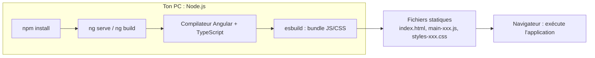
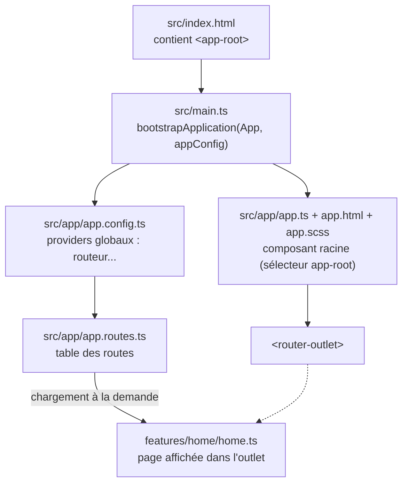

# Veille technologique : Angular

*Version Angular retenue : **22.2** (vérifiée le 27/10/2026). Chaque réponse est complétée le jour où la notion apparaît dans le projet, avec : explication accessible, réponse technique, exemple, référence officielle, lien avec le projet, exercice et question de révision.*

| # | Question | Jour | État |
|---|---|---|---|
| 1 | Qu'est-ce qu'Angular et quel est son rôle dans le développement ? Quelle est sa dernière version ? | J1 | ✅ |
| 2 | Quelles sont les principales caractéristiques et avantages d'Angular par rapport à d'autres frameworks JavaScript ? | J1 | ✅ |
| 3 | C'est quoi un CLI Angular ? | J1 | ✅ |
| 4 | C'est quoi Node ? Quelle est sa version actuelle ? | J1 | ✅ |
| 5 | Quel est le lien entre Node et Angular ? | J1 | ✅ |
| 6 | Comment créer un projet Angular ? | J1 | ✅ |
| 7 | Expliquez à l'aide d'un schéma la structure d'une application Angular (le socle généré par Angular CLI). | J1 | ✅ |
| 8 | Pouvez-vous expliquer brièvement le concept de composants et de directives dans Angular ? | J3 | ⬜ |
| 9 | Les cycles de vie d'un composant. | J7 | ⬜ |
| 10 | Expliquer le contenu d'un composant Angular. | J3 | ⬜ |
| 11 | C'est quoi un Observable ? C'est quoi une Promise ? | J3 | ⬜ |
| 12 | Différence entre un Observable et une Promise. | J3 | ⬜ |
| 13 | Qu'est-ce que RxJS ? Donnez quelques opérateurs RxJS et leurs rôles. | J4 | ⬜ |
| 14 | Comment relier une API possédant des endpoints à un projet Angular ? | J3 | ⬜ |
| 15 | Décrire le mécanisme d'un appel HTTP en Angular. | J3 | ⬜ |
| 16 | Qu'est-ce que le binding ? | J3 | ⬜ |
| 17 | Citez et expliquez les différents types de binding. | J3 | ⬜ |
| 18 | Quelle est la différence entre le binding unidirectionnel et bidirectionnel dans Angular ? | J3 | ⬜ |
| 19 | Différents moyens d'échange de données entre composants en Angular. | J7 | ⬜ |
| 20 | Expliquer ce que sont @Input et @Output et leurs utilisations. | J7 | ⬜ |
| 21 | C'est quoi le lazy loading ? | J4 | 🔄 première utilisation au J1 |
| 22 | C'est quoi un service en Angular ? | J3 | ⬜ |
| 23 | C'est quoi un provider en Angular ? | J5 | ⬜ |
| 24 | C'est quoi une directive ? | J3 | ⬜ |
| 25 | C'est quoi un provider en Angular ? (doublon de la question 23) | J5 | ↪ voir 23 |
| 26 | Pouvez-vous citer quelques balises structurelles couramment utilisées dans les templates Angular ? | J3 | ⬜ |
| 27 | Citer les différentes méthodes d'implémentation d'un formulaire en Angular. | J3, J7 | ⬜ |
| 28 | C'est quoi Webpack ? Il représente quoi pour Angular ? | J1 | ✅ |
| 29 | Qu'est-ce qu'un « type union » en TypeScript et dans quelles situations est-il utilisé ? | J8 | ⬜ |

> Les questions 23 et 25 sont identiques dans l'énoncé : la 25 renvoie à la 23. Les questions 8 et 24 se recouvrent : la 8 présente composants et directives ensemble, la 24 détaille les directives.

---

## 1. Qu'est-ce qu'Angular et quel est son rôle dans le développement ? Quelle est sa dernière version ?

**En clair** : Angular est un framework pour construire des applications web qui tournent dans le navigateur. Il fournit tout le nécessaire « clé en main » : composants, navigation, formulaires, appels HTTP, tests.

**Réponse technique** : framework open source maintenu par Google, écrit en TypeScript, pour construire des *Single Page Applications* (SPA). L'application est chargée une fois, puis le navigateur met à jour l'affichage sans recharger la page. Angular apporte un système de composants, un moteur de templates compilé à l'avance, l'injection de dépendances, un routeur, des formulaires, un client HTTP et une réactivité fondée sur les **Signals**.

**Exemple** :

```ts
@Component({
  selector: 'app-root',
  template: `<h1>{{ appName }}</h1>`,
})
export class App {
  protected readonly appName = 'Suivi des commandes';
}
```

**Référence** : <https://angular.dev/overview>

**Lien avec le projet** : tout le dossier `frontend/` ; le composant racine est `frontend/src/app/app.ts`.

**Exercice** : liste trois choses que fait Angular et qu'il faudrait coder soi-même avec du JavaScript pur.

**Révision** : qu'est-ce qu'une SPA, et quel avantage pour l'utilisateur ?

### Dernière version

**En clair** : on utilise **Angular 22.2**, la version stable actuelle. On ne prend jamais une version « next » (préversion) pour un projet.

**Réponse technique** : Angular publie une version majeure environ tous les six mois. Chaque majeure a 6 mois de support actif puis 12 mois de LTS. La v22 est sortie le 03/06/2026, en support actif jusqu'en juin 2027, puis LTS jusqu'en juin 2028. Elle impose **Node.js `^22.22.3 || ^24.15.0 || >=26.0.0`**, **TypeScript `>=6.0 <6.1`** et **RxJS `^6.5.3 || ^7.4.0`**.

Il faut distinguer :

| | Exemple au 27/10/2026 |
|---|---|
| Dernière version publiée | 22.3.0-next.3 (préversion) |
| Dernière version stable | 22.2.3 |
| Compatible avec le projet | 22.2.x |
| Installée | voir `frontend/package.json` |

**Exemple** :

```bash
npx ng version
```

**Référence** : <https://angular.dev/reference/versions>, <https://angular.dev/reference/releases>

**Lien avec le projet** : `frontend/package.json` (`"@angular/core": "^22.2.0"`, `"typescript": "~6.0.2"`).

**Exercice** : lance `npx ng version` dans `frontend/` et retrouve les versions d'Angular, de TypeScript et de RxJS.

**Révision** : pourquoi TypeScript 7, pourtant sorti, n'est-il pas utilisable ici ?

## 2. Quelles sont les principales caractéristiques et avantages d'Angular par rapport à d'autres frameworks JavaScript ?

**En clair** : tout est fourni et cohérent, le typage évite beaucoup d'erreurs, et la structure imposée aide à garder un gros projet lisible.

**Réponse technique** :

- **Framework complet** : routeur, formulaires, HTTP, tests, animations, sans assembler des bibliothèques disparates.
- **TypeScript** : erreurs détectées à la compilation, autocomplétion.
- **Compilation à l'avance** (AOT) : les templates sont vérifiés et transformés en JavaScript au build.
- **Injection de dépendances** : code découplé et facile à tester.
- **Signals** : réactivité fine, sans zone.js depuis les dernières versions.
- **Outillage officiel** : CLI, migrations automatiques (`ng update`), calendrier de versions prévisible.

Limites : courbe d'apprentissage plus raide que des bibliothèques plus légères, et davantage de concepts à maîtriser au départ.

Comparaison rapide :

| | Angular | React | Vue |
|---|---|---|---|
| Nature | Framework complet | Bibliothèque d'interface | Framework progressif |
| Langage | TypeScript imposé | JavaScript ou TypeScript (JSX) | JavaScript ou TypeScript |
| Routeur, formulaires, HTTP | Fournis officiellement | Bibliothèques tierces au choix | Routeur officiel, le reste au choix |
| Injection de dépendances | Intégrée | Absente (Context, hooks) | Simple (`provide`/`inject`) |
| Réactivité | Signals + RxJS | Hooks (`useState`...) | Refs réactives |
| Structure de projet | Très guidée par le CLI | Libre | Assez libre |

Angular est donc bien adapté aux applications métier de taille moyenne à grande, avec plusieurs développeurs, où la cohérence prime sur la liberté.

**Référence** : <https://angular.dev/overview>

**Lien avec le projet** : les tests (`app.spec.ts`), le lint et le build fonctionnent dès la génération, sans configuration.

**Exercice** : compare en cinq lignes Angular et une bibliothèque légère (React ou Vue) sur le routeur et les formulaires.

**Révision** : qu'apporte la compilation AOT au développeur ?

## 3. C'est quoi un CLI Angular ?

**En clair** : la ligne de commande officielle qui crée, lance, teste et construit le projet à ta place.

**Réponse technique** : le paquet `@angular/cli` fournit la commande `ng`. Les principales :

| Commande | Effet |
|---|---|
| `ng new` | Crée un projet |
| `ng serve` | Lance le serveur de dev avec rechargement automatique |
| `ng build` | Produit les fichiers de production dans `dist/` |
| `ng test` | Lance les tests unitaires (Vitest par défaut) |
| `ng generate component x` | Génère un composant |
| `ng add <paquet>` | Installe et configure une bibliothèque |
| `ng update` | Met à jour Angular avec migrations automatiques |

Le CLI délègue le travail aux **builders** déclarés dans `angular.json` (ici `@angular/build:application`).

**Exemple** : `npx ng generate component features/home --inline-template`

**Référence** : <https://angular.dev/tools/cli>

**Lien avec le projet** : `frontend/angular.json` ; `ng add angular-eslint` a configuré le lint.

**Exercice** : génère un composant de test avec `ng generate`, observe les fichiers créés, puis supprime-le.

**Révision** : pourquoi utiliser `npx ng` plutôt qu'un `ng` installé globalement ?

## 4. C'est quoi Node ? Quelle est sa version actuelle ?

**En clair** : Node.js permet d'exécuter du JavaScript **en dehors du navigateur**, directement sur ton ordinateur ou sur un serveur.

**Réponse technique** : environnement d'exécution JavaScript fondé sur le moteur V8 de Chrome, avec des API pour lire des fichiers, lancer des processus ou ouvrir des connexions réseau. Il est livré avec **npm**, le gestionnaire de paquets. Node publie une version paire **LTS** (support long) chaque année ; les versions impaires et les plus récentes sont « Current ».

Versions au 27/10/2026 (source : nodejs.org) :

| Ligne | Dernière version | Statut |
|---|---|---|
| 26 | 26.12.1 | Current (non LTS) |
| **24** | **24.22.1** | **LTS active (Krypton)**, celle du projet |
| 22 | 22.23.4 | LTS de maintenance (Jod) |

**Exemple** :

```powershell
node -v    # v24.22.1
npm -v
```

**Référence** : <https://nodejs.org/>

**Lien avec le projet** : la CI installe Node 24 (`.github/workflows/ci.yml`) ; tu as Node 24.22.1 sur ton PC.

**Exercice** : écris un fichier `bonjour.js` contenant `console.log('Bonjour depuis Node', process.version)` et lance-le avec `node bonjour.js`. Où s'exécute ce code ?

**Révision** : pourquoi privilégier une version LTS pour un projet ?

## 5. Quel est le lien entre Node et Angular ?

**En clair** : Node.js fait tourner les **outils** sur ta machine (CLI, compilateur, tests). L'application Angular, elle, tourne dans le **navigateur**.

**Réponse technique** : Node.js est un environnement d'exécution JavaScript hors navigateur. Il est indispensable pour npm, le CLI, le compilateur TypeScript, esbuild, Vite et Vitest. Une fois construite, l'application n'est qu'un ensemble de fichiers statiques (HTML, JS, CSS) : aucun Node.js n'est nécessaire pour la servir, sauf en rendu côté serveur (SSR), non utilisé ici.



Chaque version d'Angular exige une plage de versions de Node précise. Angular 22 exige `^22.22.3 || ^24.15.0 || >=26.0.0` : c'est pourquoi ta version 22.17 devait être mise à jour.

**Exemple** : `npm start` lance Node, qui exécute le CLI, qui lance le serveur de développement Vite sur <http://localhost:4200>.

**Référence** : <https://nodejs.org/>, <https://angular.dev/reference/versions>

**Lien avec le projet** : `"start": "ng serve"` dans `frontend/package.json`.

**Exercice** : après `npm run build`, ouvre `frontend/dist/suivi-commandes-web/browser/` et identifie les fichiers qui iront dans le navigateur.

**Révision** : Node.js est-il nécessaire sur le serveur qui héberge l'application construite ? Pourquoi ?

## 6. Comment créer un projet Angular ?

**En clair** : une seule commande crée un projet complet, prêt à lancer et à tester.

**Réponse technique** : commande utilisée pour ce projet :

```bash
npx @angular/cli@22.2.4 new suivi-commandes-web --directory frontend \
  --style=scss --ssr=false --skip-git --routing --defaults --package-manager=npm
```

| Option | Raison |
|---|---|
| `@angular/cli@22.2.4` | Version exacte, sans dépendre d'un CLI global |
| `--style=scss` | Variables et imbrication dans les styles |
| `--ssr=false` | Pas besoin de rendu côté serveur pour un outil interne |
| `--skip-git` | Le dépôt Git existe déjà à la racine |

Valeurs par défaut constatées en v22 : composants standalone, **Vitest**, **pas de zone.js** (application *zoneless*), builder `@angular/build:application`.

**Référence** : <https://angular.dev/tools/cli/setup-local>

**Lien avec le projet** : dossier `frontend/`.

**Exercice** : crée un projet jetable dans un autre dossier avec `--style=css` et compare son `angular.json` avec le nôtre.

**Révision** : que signifie « zoneless » ?

## 7. Expliquez à l'aide d'un schéma la structure d'une application Angular (le socle généré par Angular CLI).

**En clair** : la configuration est à la racine de `frontend/`, le code dans `src/app/`.

**Schéma du démarrage** :



**Schéma des fichiers** :

```
frontend/
├── angular.json         configuration du CLI et des builders
├── package.json         dépendances et scripts npm
├── tsconfig.json        options TypeScript communes
├── public/              fichiers statiques (favicon)
└── src/
    ├── index.html       page unique
    ├── main.ts          point d'entrée
    ├── styles.scss      styles globaux
    └── app/
        ├── app.ts       composant racine (classe)
        ├── app.html     son template
        ├── app.scss     ses styles
        ├── app.spec.ts  ses tests
        ├── app.config.ts
        ├── app.routes.ts
        └── features/    pages par fonctionnalité (ajouté par nous)
```

**Réponse technique** :

| Fichier | Rôle |
|---|---|
| `package.json` / `package-lock.json` | Dépendances et scripts npm ; le lock fige les versions exactes |
| `angular.json` | Configuration des builders (build, serve, test, lint) |
| `tsconfig*.json` | Options du compilateur TypeScript (application et tests) |
| `src/main.ts` | Point d'entrée : `bootstrapApplication(App, appConfig)` |
| `src/index.html` | Page HTML unique qui contient `<app-root>` |
| `src/styles.scss` | Styles globaux (ici la charte graphique) |
| `src/app/app.ts`, `.html`, `.scss` | Composant racine |
| `src/app/app.config.ts` | Providers globaux (routeur, plus tard HttpClient) |
| `src/app/app.routes.ts` | Table des routes |
| `public/` | Fichiers copiés tels quels (favicon) |

**Référence** : <https://angular.dev/reference/configs/file-structure>

**Lien avec le projet** : on ajoute `core/`, `shared/` et `features/` dans `src/app/` (voir `docs/diagrammes/architecture.md`).

**Exercice** : suis le chemin de démarrage `index.html` → `main.ts` → `app.config.ts` → `app.ts` et explique chaque étape en une phrase.

**Révision** : pourquoi commiter `package-lock.json` ?

## 28. C'est quoi Webpack ? Il représente quoi pour Angular ?

**En clair** : Webpack est un outil qui regroupe des centaines de fichiers en quelques fichiers optimisés. Angular l'a utilisé pendant des années, mais **ce projet ne l'utilise pas**.

**Réponse technique** : un *bundler* résout les `import`, regroupe le code, supprime le code mort et minifie. Jusqu'à Angular 16, le builder par défaut (`@angular-devkit/build-angular:browser`) reposait sur Webpack. Depuis, les nouveaux projets utilisent `@angular/build:application`, qui s'appuie sur **esbuild** pour le bundle et **Vite** pour le serveur de dev. Constaté dans notre projet : `angular.json` déclare `@angular/build:application`, et `@angular/build` 22.2.4 dépend d'esbuild 0.28, Vite 8.3 et Rolldown 1.2. Les builds sont nettement plus rapides (2,6 s pour notre build de production).

**Exemple** (`frontend/angular.json`) :

```json
"build": { "builder": "@angular/build:application" }
```

**Référence** : <https://angular.dev/tools/cli/build-system-migration>

**Lien avec le projet** : voir le tableau « Chaîne de build » dans `docs/diagrammes/architecture.md`.

**Exercice** : lance `npm run build` et repère dans la sortie les *Initial chunk files* et les *Lazy chunk files*. À quoi correspond le chunk `home` ?

**Révision** : quelle différence entre un bundler et un compilateur ?
